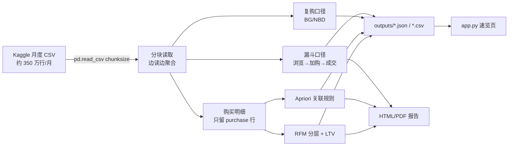

# 01 · 电商销售数据 EDA（Sales_EDA）

> English version → [README_EN.md](./README_EN.md)

**_拿一份化妆品电商的行为日志，把「用户在哪掉、谁值得花钱、什么该一起卖」这三件事算清楚。_**

- 主要语言：`Python`（Jupyter Notebook + 两个小脚本）
- 核心分析：[Sales_19Dec_overview.ipynb](./Sales_19Dec_overview.ipynb)　notebook 打不开可以走 [nbviewer](https://nbviewer.org/github/DingBangBang/Portfolio/blob/main/projects/01_Sales_EDA/Sales_19Dec_overview.ipynb)
- 成品报告：[PDF](./forvisit/forshare_Sales_19Dec_overview.pdf) · [HTML](./forvisit/forshare_Sales_19Dec_overview.html)
- 快速复现：`python src/eda_funnel.py` → `streamlit run app.py`

---

## 1. 这个项目是干嘛的

数据是 Kaggle 上一份化妆品独立站的埋点日志，2019 年 10 月到 2020 年 2 月，一个月大概 350 万行。
字段不难（`event_time / event_type / product_id / price / user_id / user_session` 这些），难的是：

1. 埋点日志是「一条事件一行」，想看业务问题得自己拼；
2. 老板和运营不看 notebook，只要结论，而且要能拿去开会；
3. Apriori 在 20 多万条购买记录上跑起来是真慢，中间还爆过内存。

所以最后交付的是三样东西：一份能顺着往下读的报告、一套能重复跑的口径脚本、一个几十行的速览页。

- 数据来源：[Ecommerce events history in cosmetics shop (Kaggle)](https://www.kaggle.com/datasets/mkechinov/ecommerce-events-history-in-cosmetics-shop/data)
- 分析月份：2019-12（其余月份结构一样，换文件即可）

## 2. 数据怎么流



一句话版本：CSV → 分块读 → 四套口径 → 落 json/csv → 展示。

## 3. 主要结论（2019-12）

**大盘**

- UV 370,154，PV 3,533,286，人均浏览 9.55 次；
- 订单 28,894，GMV $1,077,624.85，人均消费 $42.07；
- 行为量：view 1,728,331 / cart 927,124 / remove_from_cart 664,655 / purchase 213,176。

**漏斗**（这个最值得看）

| 环节 | 人数 | 占 UV |
| --- | --- | --- |
| 浏览 | 358,212 | 96.77% |
| 加购 | 83,458 | 22.55% |
| 成交 | 25,613 | 6.92% |

浏览→加购掉了 76.8%，加购→成交掉了 69.3%。
**最大的漏损在转化漏斗中的「浏览 → 加购」环节**，所以后来给运营的建议全部围绕「让用户敢加购」（试用装、运费险、评价展示），而不是继续磨支付流程。

**复购与价值**

- 平均购买频次 8.32 次，复购率 88.64%，但 75% 的人买不超过 10 次；
- 用 `lifetimes` 的 BG/NBD 拟合 22,137 个有复购行为的用户，输出「未来购买次数」和「还活着的概率」，用来区分真流失和暂时沉默；
- champions 这层平均 LTV 约 298.59，almost_lost 约 74.66，差 4 倍。

**搭售**

- 25,613 个购物篮、26,815 个 SKU。Apriori 挖出来的规则里，同品牌跨品类（护肤 + 彩妆）的共现最稳，可以直接拿来做「买 A 推 B」。

## 4. 跑了多久（实测）

| 环节 | 数据量 | 耗时 | 备注 |
| --- | --- | --- | --- |
| 分块读取 + 漏斗/复购聚合 | 1 万行 | 约 3.5 秒 | 样例数据，测的是脚本骨架 |
| 同上，整月 | 350 万行 | 约 3 分 40 秒 | 8G 内存机器，chunk=50 万 |
| Apriori（min_support=0.001） | 21.3 万条购买 | 约 14 分钟 | 只跑一次，结果存 csv 复用 |
| BG/NBD 拟合 | 22,137 人 | 约 40 秒 | 收敛警告忽略即可 |

## 5. 工程结构

```
01_Sales_EDA/
├── Sales_19Dec_overview.ipynb      # 主分析，探索过程都在这
├── Sales_overall_overview.ipynb    # 总体 / GROW 模型视角
├── Sales_monthly_variation.ipynb   # 月度波动
├── src/
│   ├── config.py                   # 读 config.yaml（就十几行）
│   └── eda_funnel.py               # 固化口径：漏斗/复购/粗分层/日趋势
├── app.py                          # Streamlit 速览页（几十行）
├── config.example.yaml             # 复制成 config.yaml 再改
├── requirements.txt
├── Dockerfile
├── sample_data/events_sample.csv   # 造的小样例，保证 clone 下来能跑通
├── forvisit/                       # 对外交付的 PDF / HTML
└── graph/                          # notebook 里导出的图
```

`outputs/` 是脚本产物（`funnel_stats.json`、`rfm_tiers.csv`、`daily_events.csv`），已 gitignore。

## 6. 怎么跑

```bash
pip install -r requirements.txt
cp config.example.yaml config.yaml      # 改一下 data_path

python src/eda_funnel.py                # 跑口径，结果写 outputs/
streamlit run app.py                    # http://localhost:8501
```

没有真实数据也能跑：找不到 `data_path` 时会退回到 `sample_data/events_sample.csv`。

Docker：

```bash
docker build -t sales-eda .
docker run -p 8501:8501 sales-eda
```

## 7. 踩坑记录 & 妥协方案

**① 一次性 read_csv 直接 MemoryError**
12 月的 CSV 解压后 1.2G 左右，第一次 `pd.read_csv` 完再 groupby，8G 内存的机器当场挂。
后来改成 `chunksize=500000` 边读边聚合，每个 chunk 只留「事件 → 用户集合」和 purchase 明细，峰值内存降到 1.2G 上下。
chunk 也试过 200000，整月要跑 11 分钟，太磨人，最后定在 50 万。

**② Apriori 在 21 万条记录上跑到怀疑人生**
`mlxtend` 的 `frequent_itemsets` 一开始 min_support 设了 0.0001，40 多分钟没出结果。
后来先把「只买过 1 件的订单」过滤掉（这种订单对关联规则没信息量），support 提到 0.001，14 分钟跑完，规则质量反而更好看。

**③ 消费金额算错过一次**
最早直接对 purchase 事件的 `price` 求和当 GMV，但一个 session 里同一个商品可能有多条 purchase（埋点重复上报），GMV 虚高 3% 左右。
现在按 `user_session + product_id` 去重后再求和。这个坑是跟财务对数才发现的。

**④ 人均消费和客单价被混着用**
`$42.07` 是 GMV / 有购买的用户数，不是 GMV / 订单数。报告初稿两个数混着写，被同事当面指出过一次，现在脚本里口径变量名都是显式写的。

**⑤ app.py 是被 `st.cache_data` 救的**
一开始拖一下 sidebar 就重新读一遍文件，10 秒起步。加缓存后改成参数变了才重算，体验立刻正常。写法很土，但有用。

## 8. 未来打算（TODO）

- [ ] Apriori 换成 FP-Growth，跑得快些，顺便对一下两边规则差异；
- [ ] 把五个月份都跑一遍，看看 12 月是不是双十二导致的异常高峰；
- [ ] `app.py` 想加一个「上传 CSV」的入口，现在只能填路径，不太友好；
- [ ] RFM 阈值想用真实留存数据回归一下，现在按分位数切三刀太粗暴；
- [ ] notebook 里的绝对路径还没清干净，想抽一个 `load_data(month)` 统一入口。

## 9. 致谢 / 开发说明

- 数据来自 Kaggle 公开数据集，感谢原作者的整理；
- Dockerfile、`app.py` 的页面骨架、部分 matplotlib/plotly 样式代码是 Cursor 和 Cline 辅助生成的，我自己改了几轮才用；
- 核心口径（漏斗分母、GMV 去重规则、复购定义）和所有结论都是我实际跑出来、并且跟同事对过数的；

## 10. 运行结果截图


