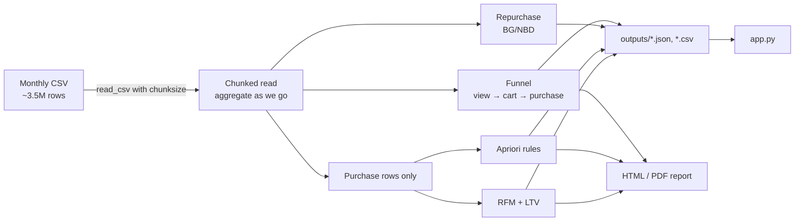

# 01 · E-commerce Sales EDA (Sales_EDA)

> 中文版 → [README.md](./README.md)

**_A cosmetics store's event log, squeezed into three answers: where users drop off, who is worth spending on, and what should be sold together._**

- Language: `Python` (Jupyter Notebook + two small scripts)
- Main analysis: [Sales_19Dec_overview.ipynb](./Sales_19Dec_overview.ipynb) · [nbviewer mirror](https://nbviewer.org/github/DingBangBang/Portfolio/blob/main/projects/01_Sales_EDA/Sales_19Dec_overview.ipynb)
- Readable artefacts: [Report PDF](./forvisit/forshare_Sales_19Dec_overview.pdf) · [HTML](./forvisit/forshare_Sales_19Dec_overview.html)
- Quick start: `python src/eda_funnel.py` then `streamlit run app.py`

---

## 1. Why this exists

The input is a public Kaggle event log for a cosmetics shop (Oct 2019 – Feb 2020, roughly 3.5M rows per month). The columns are nothing special, the annoying parts were:

1. it is one row per event, so every business question needs its own aggregation;
2. nobody in the meeting reads notebooks, they want the conclusion and a chart they can screenshot;
3. Apriori on 200k+ purchase rows is genuinely slow, and it blew up memory once.

So the deliverable is three things: a readable report, a set of re-runnable metric scripts, and a small dashboard page.

- Source: [Ecommerce events history in cosmetics shop (Kaggle)](https://www.kaggle.com/datasets/mkechinov/ecommerce-events-history-in-cosmetics-shop/data)
- Month analysed: 2019-12

## 2. Data flow



## 3. What the numbers said (2019-12)

**Overall**

- UV 370,154, PV 3,533,286, ~9.55 views per user;
- 28,894 orders, GMV $1,077,624.85, $42.07 per paying user;
- Events: view 1,728,331 / cart 927,124 / remove_from_cart 664,655 / purchase 213,176.

**Funnel**

| Step | Users | % of UV |
| --- | --- | --- |
| view | 358,212 | 96.77% |
| cart | 83,458 | 22.55% |
| purchase | 25,613 | 6.92% |

View → cart loses 76.8%; cart → purchase loses 69.3%.
**The big leak is view → cart**, so every recommendation I gave the ops team was about making people comfortable adding to cart (samples, shipping insurance, visible reviews), not about the checkout flow.

**Repurchase and value**

- Average purchase frequency 8.32, repurchase rate 88.64%, yet 75% of buyers purchased 10 times or fewer;
- A `lifetimes` BG/NBD model on 22,137 repeat buyers estimates future purchases and P(alive), which separates real churn from temporary silence;
- Champions average LTV ≈ 298.59 vs ≈ 74.66 for almost-lost users — a 4x gap.

**Bundling**

- 25,613 baskets, 26,815 SKUs. The most stable Apriori rules are cross-category, same-brand (skincare + makeup), which is directly usable as "bought A, suggest B".

## 4. Timings (measured on my machine)

| Step | Volume | Time | Note |
| --- | --- | --- | --- |
| Chunked read + funnel/repurchase | 10k rows | ~3.5s | sample data, measures the script skeleton |
| Same, full month | 3.5M rows | ~3m40s | 8GB RAM, chunk=500k |
| Apriori (min_support=0.001) | 213k purchases | ~14 min | run once, cached to csv |
| BG/NBD fit | 22,137 users | ~40s | convergence warnings can be ignored |

## 5. Layout

```
01_Sales_EDA/
├── Sales_19Dec_overview.ipynb      # main analysis (all the exploration)
├── Sales_overall_overview.ipynb    # overall / GROW-model view
├── Sales_monthly_variation.ipynb   # month-over-month variation
├── src/
│   ├── config.py                   # reads config.yaml (~15 lines)
│   └── eda_funnel.py               # funnel / repurchase / rough RFM / daily events
├── app.py                          # tiny Streamlit page
├── config.example.yaml
├── requirements.txt
├── Dockerfile
├── sample_data/events_sample.csv   # small synthetic sample so the repo runs out of the box
├── forvisit/                       # PDF / HTML deliverables
└── graph/                          # exported charts
```

`outputs/` (`funnel_stats.json`, `rfm_tiers.csv`, `daily_events.csv`) is gitignored.

## 6. How to run

```bash
pip install -r requirements.txt
cp config.example.yaml config.yaml      # point data_path at your CSV

python src/eda_funnel.py
streamlit run app.py                    # http://localhost:8501
```

No real data? It falls back to `sample_data/events_sample.csv`.

Docker:

```bash
docker build -t sales-eda .
docker run -p 8501:8501 sales-eda
```

## 7. Things that went wrong (and the compromises I made)

**1) One-shot `read_csv` → MemoryError.**
The December file is ~1.2GB in memory; read it whole and group it on an 8GB laptop and it dies. Switched to `chunksize=500000` and aggregate per chunk, keeping only user-sets per event plus the purchase rows. Peak memory dropped to about 1.2GB. I tried 200k chunks first — 11 minutes for a month, too slow, so 500k it is.

**2) Apriori took forever on 213k rows.**
First run with `min_support=0.0001` produced nothing after 40+ minutes. Dropped single-item orders (they carry no co-occurrence signal), lifted support to 0.001, finished in 14 minutes and the rules actually looked better.

**3) I got GMV wrong once.**
I initially summed `price` over all purchase events, but the same product can be reported twice inside one session, which inflated GMV by ~3%. Now I dedupe on `user_session + product_id` before summing. Found it while reconciling with finance.

**4) ARPU vs AOV — I mixed them up.**
$42.07 is GMV / paying users, not GMV / orders. The first draft of the report used them interchangeably; a colleague called it out. The script now names every metric explicitly.

**5) `st.cache_data` saved the dashboard.**
Every sidebar tweak re-read the file — 10s each time. Caching on the function arguments fixed it. Not elegant, but it works.

## 8. TODO

- [ ] Swap Apriori for FP-Growth and compare the rule sets;
- [ ] Run all five months to check whether December is just a double-12 spike;
- [ ] Add a CSV upload widget to `app.py`, typing a path is not friendly;
- [ ] Calibrate the RFM cut-offs with real retention data instead of quantiles;
- [ ] Remove the absolute paths left in the notebook and expose a single `load_data(month)`.

## 9. Credits / how this was built

- Dataset: Kaggle public data, thanks to the original author;
- The Dockerfile, the `app.py` page skeleton and some of the matplotlib/plotly styling were drafted with Cursor and Cline, then edited by me;
- Metric definitions (funnel denominators, GMV dedupe rule, repurchase definition) and all findings are mine, verified against numbers a colleague checked.

## 10. Screenshots

See the image gallery at the end of [README.md](./README.md) — same screenshots, kept in one place to avoid duplicating 10 links.
