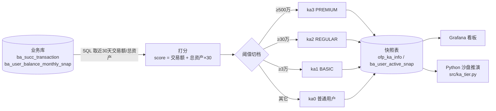

# 02 · VIP(KA) 分层与看板（KA_Dashboard）

> English version → [README_EN.md](./README_EN.md)

**_用 SQL 把「谁是大客户、给什么等级」定下来，再把结果做成 Grafana 上能天天看的看板。_**

- 主要语言：`SQL`（MySQL / TiDB 语法）+ 一点 `Python`（上线前沙盘推演）
- 核心文件：[ka_dashboard_sql.sql](./ka_dashboard_sql.sql)
- 看板结构：[Grafana_VIP_Dashboard_v2_Structure.png](./Grafana_VIP_Dashboard_v2_Structure.png) · 分层体系：[VIP_hirarchy_system.png](./VIP_hirarchy_system.png)

---

## 1. 为什么要做这个

运营那边原来评大客户是靠客户经理提名，问题很直接：

1. 同一个客户，A 经理说是 VIP，B 经理说不算，没有共同标准；
2. 有个用户一个月没交易，但他账户里躺着 100 万美金，没人把他算进来；
3. 规则一改，第二天客服电话就被打爆 —— 一批人莫名其妙掉级了。

所以这件事故成两半：**分层规则写死在 SQL 里**（可复现、可解释），**上线前先用历史数据沙盘推演**（看看会掉多少人）。

## 2. 数据怎么流



## 3. 分层口径

`score = 近 30 天交易额（CNY）+ 总资产（可用 + 冻结 + 理财）× 30`

| 档位 | 阈值 | 业务含义 |
| --- | --- | --- |
| ka3 / PREMIUM | ≥ 5,000,000 | 客户经理一对一，专属费率 |
| ka2 / REGULAR | ≥ 300,000 | 有专属客服 |
| ka1 / BASIC | ≥ 30,000 | 基础权益 |
| ka0 | 其它 | 普通用户 |

×30 这个系数被问过很多次：资产是存量、交易额是流量，要让「一个月不交易但资产厚」的人也能进 KA，折算系数是跟业务一起讨论定的，不是纯拍的。

## 4. 看板上都看什么

- **人数与资产分布**：各档人数、各档资产合计，验证帕累托（越上面人越少、钱越集中）；
- **活跃**：DAU / MAU，以及把活跃拆成「登录 / 交易（BUY·SELL）/ 用券」三种口径，KA 在各口径下的占比；
- **留存**：按周 / 月看 KA 的留存曲线，和普通用户对比；
- **搅动（reshuffle）**：升级 / 降级次数，取 10 个时间点抽样看稳定性。

## 5. ‼️沙盘推演

新规则不敢直接上线，先做三件事：

1. 取 10 个历史时间点，用新规则重新分层；
2. 对比「新旧规则下的人数分布、余额分布」；
3. 数每个人在这 10 个点上被升降级了几次 —— 抖动太厉害就说明规则不稳。

Python 版脚本（`src/ka_tier.py`）就是这个流程的精简版，阈值写在 `config.example.yaml`，改完直接重跑：

```bash
python src/ka_tier.py           # 用 sample_data 的两个快照做对比
python src/ka_tier.py --use-db --date 2023-06-01
```

## 6. 工程结构

```
02_KA_Dashboard/
├── ka_dashboard_sql.sql              # 核心 SQL：分层规则 + 指标口径 + 快照写入
├── pretest_hirarchyV2.ipynb          # 当初的沙盘推演 notebook
├── src/ka_tier.py                    # 沙盘推演的脚本版（可反复改阈值跑）
├── config.example.yaml               # 阈值、数据库连接（密码走 .env）
├── .env.example
├── docker-compose.yml                # 本地 MySQL 8
├── docker/mysql/init/01_schema.sql   # 建表 + 几条演示数据
├── sample_data/ka_snapshot_sample.csv
├── Grafana_VIP_Dashboard_v2_Structure.png
└── VIP_hirarchy_system.png
```

## 7. 怎么跑

```bash
# 1) 起本地库（可选，只想跑脚本可以跳过）
docker compose up -d

# 2) 装依赖，配连接
pip install -r requirements.txt
cp .env.example .env        # 填密码
cp config.example.yaml config.yaml

# 3) 跑推演
python src/ka_tier.py                        # 样例 CSV
python src/ka_tier.py --use-db --date 2023-06-01   # 走 MySQL
```

产物在 `outputs/`：`tier_dist_<date>.csv`、`tier_change.csv`。

真实的业务表（`ofp_ka_info`、`ofp_user`、`ba_succ_transaction` 等）没法放进仓库，`01_schema.sql` 只建了一张快照表用来验证脚本能跑通。

## 8. 踩坑记录 & 妥协方案

**① 规则一上线，客服被打爆**
第一版只按「近 30 天交易额」分层，结果一大批「长期不交易但资产很多」的老客户掉到普通用户，一周内客诉翻倍。
补上总资产并加折算系数后才稳住。这件事之后才有「上线前必须沙盘推演」这条规矩。

**② TiDB 上 `subdate` 和 MySQL 表现不一样**
周口径用的是 `subdate(date, weekday)` 的写法，在 MySQL 上没问题，挪到 TiDB 某版本上遇到日期为周日时的边界差异，统计出来的周起始日整体偏了一天。
最后的妥协是：所有周口径都改成显式算「本周一」，不再依赖 `subdate` 的隐式行为。

**③ 快照表一天天涨**
一开始每天全量写一份 `ba_user_active_snap`，三个月就上千万行，Grafana 加载开始卡。
现在只保留最近 90 天的日快照，更早的按月聚合。粗暴但有效。

**④ Grafana 上直接跑重 SQL**
最早面板直接查原始交易表做 group by，点一次 20 多秒，被吐槽「点开就想关」。
后来全部改成查预聚合快照表，面板打开 1 秒内。

**⑤ Python 脚本和 SQL 的算法必须一模一样**
这个是硬要求：沙盘推演用的是 Python 打分，线上是 SQL 打分，两边只要有一边改了阈值另一边忘了，推演结论就全废。
现在阈值统一写在 `config.example.yaml` 和 SQL 顶部，改的时候两边一起改（很土，但比写双份逻辑靠谱）。

## 9. 未来打算（TODO）

- [ ] 阈值想从「业务拍」改成「按 ARPU 分布拐点定」，现在还是经验值；
- [ ] 分层想加一个「交易频次」维度，纯金额容易被刷量的账户钻空子；
- [ ] `src/ka_tier.py` 里连库那段还没加连接池，一天跑一次够用，量上来要改；
- [ ] 想看能不能用 dbt 把这一堆 SQL 管起来，现在纯手工维护，改字段靠搜索；
- [ ] Grafana 面板的 json 没放进仓库，想脱敏后放一份，方便别人直接 import。

## 10. 致谢 / 开发说明

- SQL 主体、指标口径和沙盘推演思路都是从0到1写出来的，跑在生产上对过数；
- `src/ka_tier.py` 的脚手架、`docker-compose.yml` 和 `01_schema.sql` 由 Cline 辅助生成，我改掉了默认参数并补了注释；
- 分层阈值为业务讨论结果，这里展示的数值已脱敏，不代表线上真实阈值。
