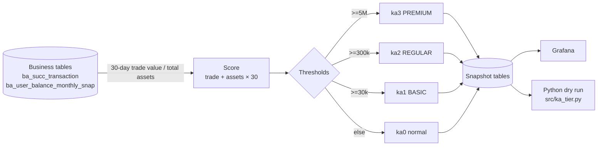

# 02 · VIP (KA) Tiering and Dashboard (KA_Dashboard)

> 中文版 → [README.md](./README.md)

**_Define who counts as a key account in SQL, then put the result on a Grafana board people actually look at every day._**

- Language: `SQL` (MySQL / TiDB) + a bit of `Python` for pre-release dry runs
- Core file: [ka_dashboard_sql.sql](./ka_dashboard_sql.sql)
- Dashboard layout: [structure image](./Grafana_VIP_Dashboard_v2_Structure.png) · tier system: [VIP_hirarchy_system.png](./VIP_hirarchy_system.png)

---

## 1. Why

The ops team used to let account managers nominate VIPs, and it went exactly as expected:

1. two managers disagreed on the same client, no shared standard;
2. a user with $1M sitting in the account but no trade for a month was not counted as VIP;
3. the day a rule changed, support got flooded — a bunch of people silently dropped a tier.

So the work split in two: **encoding the tiering rule in SQL** (reproducible, explainable), and **dry-running it against history before release** (to see how many people would drop).

## 2. Data flow



## 3. Rule

`score = last-30-day trade value (CNY) + total assets (available + frozen + wealth) × 30`

| Tier | Threshold | Meaning |
| --- | --- | --- |
| ka3 / PREMIUM | >= 5,000,000 | dedicated manager, custom fee |
| ka2 / REGULAR | >= 300,000 | dedicated support |
| ka1 / BASIC | >= 30,000 | basic benefits |
| ka0 | otherwise | normal user |

The ×30 weight keeps coming up: assets are a stock, trade value is a flow, and the business wanted "rich but quiet" accounts counted. The number came out of a discussion with the business side, not a formula.

## 4. What the board shows

- headcount and asset distribution per tier (Pareto check: fewer people, more money as you go up);
- DAU / MAU, with activity broken into login / trade (BUY, SELL) / coupon use, and KA share under each definition;
- retention curves for KA vs normal users;
- reshuffle: upgrade / downgrade counts over 10 sampled timestamps.

## 5. Dry run before release

1. take 10 historical timestamps, re-tier them with the new rule;
2. compare headcount and balance distribution, old vs new;
3. count how many times each user changed tier across those 10 points — too much churn means the rule is unstable.

`src/ka_tier.py` is the trimmed script version; thresholds live in `config.example.yaml`.

```bash
python src/ka_tier.py                                  # sample snapshots
python src/ka_tier.py --use-db --date 2023-06-01       # against MySQL
```

## 6. Layout

```
02_KA_Dashboard/
├── ka_dashboard_sql.sql              # tiering, metrics, snapshot writes
├── pretest_hirarchyV2.ipynb          # the original dry-run notebook
├── src/ka_tier.py                    # script version, re-runnable
├── config.example.yaml               # thresholds + DB config (password via .env)
├── .env.example
├── docker-compose.yml                # local MySQL 8
├── docker/mysql/init/01_schema.sql   # minimal schema + a few demo rows
└── sample_data/ka_snapshot_sample.csv
```

## 7. How to run

```bash
docker compose up -d                      # optional
pip install -r requirements.txt
cp .env.example .env                      # fill in the password
cp config.example.yaml config.yaml
python src/ka_tier.py                     # sample CSV
```

Outputs land in `outputs/` (`tier_dist_<date>.csv`, `tier_change.csv`).

The real business tables cannot be shipped, so `01_schema.sql` only creates the snapshot table needed to prove the script runs.

## 8. Things that went wrong (and the compromises)

**1) Support got flooded the first time the rule shipped.**
V1 only used 30-day trade value, so a lot of "rich but quiet" old clients dropped to normal users and complaints doubled within a week. Adding total assets (with a weight) fixed it. That incident is why dry runs are now mandatory.

**2) `subdate` behaves differently on TiDB.**
The weekly bucket used `subdate(date, weekday)`; fine on MySQL, but on one TiDB version the week boundary shifted by a day on Sundays, which quietly skewed every weekly number. Compromise: compute "Monday of this week" explicitly everywhere instead of relying on implicit behaviour.

**3) Snapshot tables grew forever.**
Writing a full daily snapshot of `ba_user_active_snap` reached tens of millions of rows in three months and Grafana started to lag. Now daily snapshots are kept for 90 days, older data is rolled up monthly. Blunt, but it works.

**4) Heavy SQL straight into Grafana.**
Panels used to group by on raw transaction tables — 20+ seconds per click, people stopped opening it. Everything now reads pre-aggregated snapshots and opens in under a second.

**5) Python and SQL must stay in sync.**
The dry run scores in Python, production scores in SQL. If one side changes a threshold and the other does not, the whole dry run is worthless. Thresholds now live in `config.example.yaml` and at the top of the SQL file, and both get changed together. Ugly, but safer than duplicating logic.

## 9. TODO

- [ ] Derive thresholds from the ARPU distribution instead of business intuition;
- [ ] Add a trade-frequency dimension — pure volume can be gamed by wash trading;
- [ ] `src/ka_tier.py` has no connection pooling; fine for a daily run, not for anything heavier;
- [ ] Try managing this pile of SQL with dbt; right now changing a column means grepping;
- [ ] The Grafana panel JSON is not in the repo; a sanitised copy would help people import it directly.

## 10. Credits

The SQL, metric definitions and the dry-run approach are mine and were validated in production. The scaffolding of `src/ka_tier.py`, `docker-compose.yml` and `01_schema.sql` was drafted with Cline and then edited. Threshold values shown here are sanitised.
