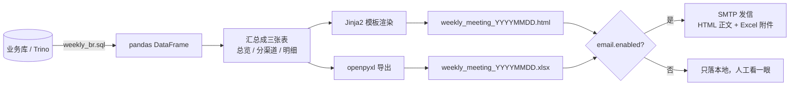

# 03 · 周期报表自动化（Periodic_Reports_Automation）

> English version → [README_EN.md](./README_EN.md)

**_把「周一早上手工做周报」这件事，换成一条脚本：SQL 取数 → pandas 汇总 → Jinja2 渲染 HTML → 出 Excel → 发邮件。_**

- 主要语言：`Python` `SQL` `HTML`
- 原版实现：[CEX_weekly_report_for_meeting_brl_NEW.ipynb](./CEX_weekly_report_for_meeting_brl_NEW.ipynb)（历史 notebook，没删，留个来路）
- 现在在用的：[src/report_pipeline.py](./src/report_pipeline.py)
- 成品样子：[周报](./CEX_automated_weekly_report.jpg) · [月报](./CEX_automated_monthly_report.jpg)

---

## 1. 痛点很具体

每周一早上九点半开周会，八点半要交报表。原来这套流程是：

1. 打开 notebook，改开始/结束日期；
2. 逐段跑 SQL，中间有一段特别容易超时，得重试；
3. 把 dataframe 复制到 Excel，手动调列宽、加粗、贴图；
4. 截图成图片，贴到邮件正文（因为老板在手机上看表会串行）；
5. 发出去。

整套坐下来 40 分钟起步，改一个数字重跑再花 5 分钟，而且每周口径都可能不一致 —— 比如「这周」到底算到周日还是周六，不同人做出来的数能差一截。

所以目标很简单：**一条命令出结果，口径写死在 SQL 里，人只负责看。**

## 2. 数据怎么流



## 3. 报表里有什么

```
1. 总览       交易额 / 笔数 / 交易用户 / 新增 / KYC 成功率 + 周环比
2. 分渠道     Google / Facebook / Referral / Organic 的交易额、环比、首充率
3. 明细       当周各渠道原始行，方便有人质疑数字时翻
```

首充率是我坚持要加的一列：只看交易额，渠道质量完全看不出来，有的渠道量大但全是刷的，首充率一摊开就很明显。

## 4. 实际耗时

| 步骤 | 原来（手工 notebook） | 现在（脚本） |
| --- | --- | --- |
| 取数 | 3~8 分钟，偶发超时重试 | 约 6 秒（样例数据 0.1 秒） |
| 汇总 + 渲染 | 人工 15~20 分钟 | 约 1.2 秒 |
| 导出 Excel | 人工调格式 10 分钟 | 约 0.4 秒 |
| 发信 | 手工贴图 | 约 2 秒 |
| **合计** | **约 40 分钟** | **约 10 秒 + 人工核对 3 分钟** |

一年 50 周，省下来的时间大概 30 多个小时。钱没省多少，但周一早上不用慌。

## 5. 工程结构

```
03_Periodic_Reports_Automation/
├── src/report_pipeline.py                    # 现在的主流程（取数→汇总→渲染→发信）
├── templates/weekly_report.html.j2           # 邮件 HTML 模板
├── config.example.yaml                       # 数据源、收件人、模板路径
├── .env.example                              # SMTP_PASSWORD 放这里
├── requirements.txt
├── Dockerfile
├── weekly_br.sql                             # 周报取数 SQL（口径都在里面）
├── sample_data/weekly_metrics.csv            # 样例数据，能直接跑通
├── CEX_weekly_report_for_meeting_brl_NEW.ipynb  # 历史 notebook
├── retail_weekly_monthly_report_auto.ipynb   # 通用化框架（历史）
└── outputs/                                  # 产物，已 gitignore
```

## 6. 怎么跑

```bash
pip install -r requirements.txt
cp config.example.yaml config.yaml
cp .env.example .env                 # 只有发邮件时才算必要

python src/report_pipeline.py                    # 样例数据，落 HTML + Excel
python src/report_pipeline.py --date 2023-05-29  # 指定某一周
python src/report_pipeline.py --send             # 真的发邮件（config 里 enabled 也要开）
```

Docker：

```bash
docker build -t weekly-report .
docker run --rm -v "$PWD/outputs:/app/outputs" weekly-report
```

## 7. 踩坑记录 & 妥协方案

**① 「这周」到底从哪天算起**
这是最要命的：最早 SQL 里用 `subdate(date, weekday)` 算周一，周日那天的数据会被算到下一周去，导致每周的合计对不上财务。
后来所有周口径统一成「显式算周一」，并且周报里直接打印周期日期，让看的人自己也能核对。

**② pyppeteer 截图很不稳**
为了让老板在手机上看，原来会把 HTML 截图成 png 贴进邮件。这个截图偶尔会卡住（等字体加载），有一次直接挂了两分钟，报表没发出去。
最后的妥协：**不上截图了**，改成 HTML 邮件（大部分客户端能正常渲染），并且附 Excel。谁要图自己截，比等脚本靠谱。

**③ 邮件被限流**
公司 SMTP 对同一发件人有限制，周报、月报、日报如果同一分钟发，会被退信。
加了一个很粗暴的处理：发信失败时 sleep 30 秒重试一次，还不行就把 HTML 落本地并打印警告，**不阻塞后面的事**。

**④ Excel 里中文列宽很丑**
openpyxl 按字符宽度算，中文字符占两个宽度，自动列宽基本不能用。现在是手写了一个宽度映射表（`zip("ABCDEFG", (26, 18, ...))`），够看就行，没做自适应。

**⑤ SQL 里带分号会切错**
`load_from_trino` 是按 `;` 切开逐段执行的，如果注释里出现分号就会崩。这个我知道，但 SQL 文件是自己维护的，写的时候注意点就行 —— 真要做成通用模块得上 sqlparse，暂时没这个必要。

**⑥ 早期把 SMTP 密码写在 notebook 里**
自查提交记录的时候发现过一次，赶紧删了并改了密码。现在统一走 `.env`，`config.example.yaml` 里只留占位符。

## 8. 未来打算（TODO）

- [ ] 想想能不能把 Excel 附件换成一页 PDF，手机上看 PDF 比 xlsx 舒服；
- [ ] 发信重试现在是 sleep 固定 30 秒，想改成指数退避；
- [ ] 分渠道那张表想加一列「上周首充率」做对比，现在只有本周的；
- [ ] `weekly_br.sql` 越来越长，想按模块拆成 4 个文件再拼；
- [ ] 想把「发信成功/失败」记到一张表里，方便查「上周周报到底发没发」。

## 9. 致谢 / 开发说明

- SQL 口径、报表结构、周会上的结论都是从0到1，跟运营对过数，也做过相应的技术培训和分享，在生产环境成功运行28个月+，期间两次小功能迭代，无需大改版；
- `report_pipeline.py` 的骨架、Jinja2 模板的 HTML 结构、Dockerfile 由Agent辅助生成，模板我按实际报表样子改了两轮；
- `sample_data/weekly_metrics.csv` 是照着真实报表的量级造的假数据，不是线上数据。
