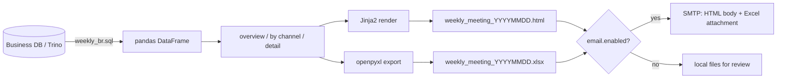

# 03 · Periodic Report Automation (Periodic_Reports_Automation)

> 中文版 → [README.md](./README.md)

**_Turn "build the weekly report by hand every Monday" into one command: SQL → pandas → Jinja2 HTML → Excel → email._**

- Language: `Python` `SQL` `HTML`
- Original implementation: [CEX_weekly_report_for_meeting_brl_NEW.ipynb](./CEX_weekly_report_for_meeting_brl_NEW.ipynb) (kept for history)
- What runs now: [src/report_pipeline.py](./src/report_pipeline.py)
- Output samples: [weekly](./CEX_automated_weekly_report.jpg) · [monthly](./CEX_automated_monthly_report.jpg)

---

## 1. The pain, concretely

Weekly meeting at 9:30 Monday, report due 8:30. The old process:

1. open the notebook, edit start/end dates;
2. run SQL cell by cell, one of them loved to time out and needed retries;
3. copy dataframes into Excel, fix column widths, bold, paste charts;
4. screenshot the result and paste it into the email body (the boss reads mail on a phone, tables fall apart);
5. send.

About 40 minutes, plus 5 more per correction, and every week someone disagreed about whether "this week" ends Saturday or Sunday — numbers differed by a noticeable margin.

Goal: **one command, metric definitions frozen in SQL, humans only review.**

## 2. Data flow



## 3. What is in the report

```
1. Overview    trade amount / cases / users / new users / KYC success + WoW
2. By channel  Google, Facebook, Referral, Organic: amount, WoW, first-deposit rate
3. Detail      raw rows for the week, for when someone questions a number
```

The first-deposit rate column was my addition. Volume alone hides channel quality — some channels look great until you spread the first-deposit rate next to them.

## 4. Timings

| Step | Before (manual) | Now (script) |
| --- | --- | --- |
| Query | 3–8 min, retries | ~6s (0.1s on sample data) |
| Aggregate + render | 15–20 min manual | ~1.2s |
| Excel export | 10 min of formatting | ~0.4s |
| Send | manual image pasting | ~2s |
| **Total** | **~40 min** | **~10s + 3 min human check** |

~30 hours a year saved. Not a money story, it just means Monday mornings are no longer stressful.

## 5. Layout

```
03_Periodic_Reports_Automation/
├── src/report_pipeline.py                   # query → aggregate → render → send
├── templates/weekly_report.html.j2
├── config.example.yaml
├── .env.example                             # SMTP_PASSWORD lives here
├── requirements.txt
├── Dockerfile
├── weekly_br.sql
└── sample_data/weekly_metrics.csv
```

## 6. How to run

```bash
pip install -r requirements.txt
cp config.example.yaml config.yaml
python src/report_pipeline.py                    # local files only
python src/report_pipeline.py --date 2023-05-29
python src/report_pipeline.py --send              # also needs email.enabled: true
```

## 7. Things that went wrong (and the compromises)

**1) When does "this week" start.**
The SQL used `subdate(date, weekday)` to find Monday, which pushed Sunday's data into the next week and made weekly totals disagree with finance. Every week bucket now computes Monday explicitly, and the report prints the period dates so readers can check it themselves.

**2) pyppeteer screenshots were flaky.**
Screenshots of the HTML were attached so the boss could read on a phone. Once it hung for two minutes waiting on fonts and the report never went out. Compromise: **dropped screenshots entirely**, switched to an HTML email body (renders fine in most clients) plus Excel. Whoever wants an image can take one.

**3) SMTP rate limits.**
Sending weekly + monthly + daily in the same minute got us bounced. Crude fix: retry once after a 30 second sleep; if it still fails, write the HTML locally and log a warning instead of blocking everything downstream.

**4) Chinese column widths in Excel.**
openpyxl measures in characters and CJK glyphs are double width, so auto-fit is useless. Hardcoded a width map. Good enough, no adaptive logic.

**5) Splitting SQL on `;` breaks on comments.**
`load_from_trino` executes statement by statement. A semicolon inside a comment breaks it. I know; the SQL file is mine and I keep it clean. Doing it properly means pulling in `sqlparse`, which is not worth it yet.

**6) The SMTP password used to be in the notebook.**
Caught it during a pre-push review, rotated the password. Everything goes through `.env` now, `config.example.yaml` only holds placeholders.

## 8. TODO

- [ ] Try replacing the Excel attachment with a one-page PDF — better on phones;
- [ ] Retry uses a fixed 30s sleep, switch to exponential backoff;
- [ ] Add "last week's first-deposit rate" next to this week's;
- [ ] `weekly_br.sql` keeps growing, split it into four module files;
- [ ] Log send success/failure to a table so "did last week's report go out?" is answerable.

## 9. Credits

The SQL, report structure and the meeting conclusions are mine (numbers reconciled with ops). The scaffolding of `report_pipeline.py`, the Jinja2 HTML and the Dockerfile were drafted with Cline and Cursor, then adjusted to match the real report. `sample_data/weekly_metrics.csv` is synthetic, sized to look like the real thing.
