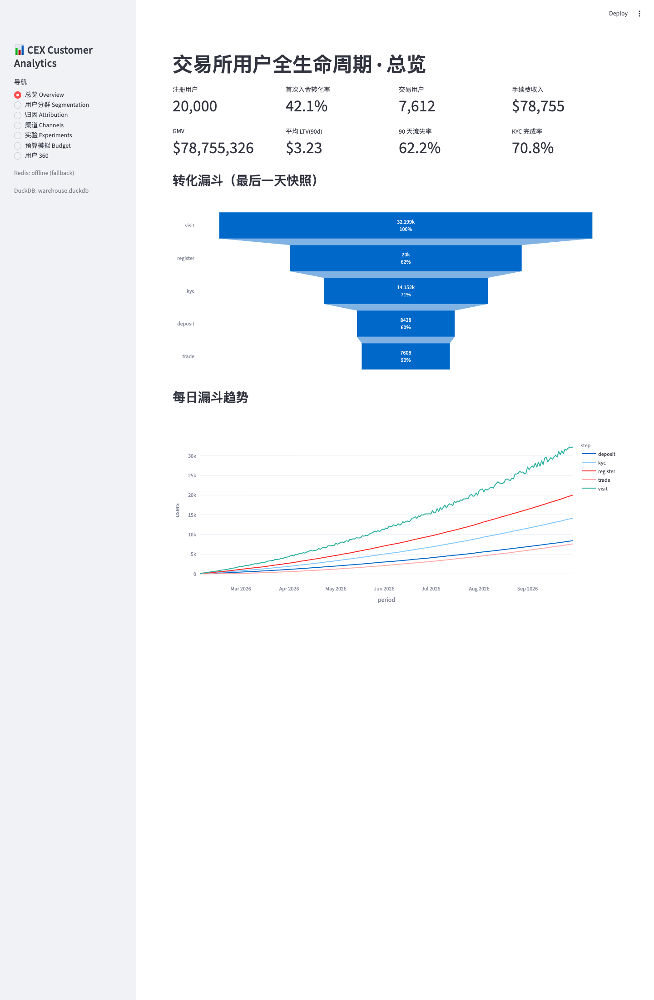

# 04 · Exchange User Full-Lifecycle Analytics (Customer_Analysis_BA)

> 中文版 → [README.md](./README.md)

**_A blueprint for full-lifecycle analytics on a centralised exchange (CEX): from the sign-up conversion funnel and RFM segmentation, through churn survival analysis, to LTV prediction, marketing attribution and incremental-ROI measurement._**

- Language: `Python` `SQL`
- Status: **planned**. This README is the full implementation blueprint (background / approach / data / steps / dev docs / deliverables); code and data will be built out following it.

---

## 1. Background

Growth teams at exchanges suffer from three things they cannot articulate:

1. **Where users get stuck** — sign-ups go up but deposits do not, and nobody knows the drop-off at each step;
2. **Whether spend is worth it** — ads, channels, social and campaigns all run at once, yet only last-touch is visible; the question "how much net-new did this channel contribute" goes unanswered;
3. **How to spend next quarter** — budget allocation is gut-feel; when management asks "if we add $100k to channel X, what happens to OKRs", no one can give a number.

This project builds a **reproducible, explainable, actionable** analytics system to answer all three — and lands the results as tools (dashboards / a simulator / a tag system) rather than a one-off report.

Audience: growth leads, operations, marketing and management.

## 2. Framework & Approach

I structure the whole thing as four progressive layers — **see it → attribute it → predict it → decide it** — so the work never starts by piling on models:

```
Layer 0  Data foundation   tables / tracking / metric definitions / data quality
   │
Layer 1  Describe         metrics + funnel + RFM segmentation + behavioural psychology + flow graph
   │
Layer 2  Attribute        funnel attribution + survival (Cox) + multi-model attribution + channel quality (Shapley)
   │
Layer 3  Predict          LTV (BG/NBD vs ML) + CAC/CPA/ROI + causal inference (incrementality)
   │
Layer 4  Decide           tag system + VIP mechanism + refined-ops framework + budget simulator + OKR attribution
```

Three principles run throughout:

- **Definitions first** — write down numerator/denominator/window/dedup rules before any analysis; every conclusion shares one definition set;
- **Correlation ≠ causation** — any "A caused B" claim must survive a counterfactual / randomised experiment / regression discontinuity;
- **Built for decisions** — every analysis ends with a "so what next" action, otherwise it does not ship.

## 3. Data Design

### 3.1 Sourcing strategy

Rather than depending on one ready dataset, I use **"public datasets as a base + synthetic augmentation"**:

- **Public datasets** (to calibrate distributions for behaviour, transactions, attribution):
  - Kaggle *eCommerce events history* (funnel, category, price distributions);
  - Criteo / marketing-funnel style attribution datasets (multi-channel touchpoint order);
  - public crypto trading / deposit-withdrawal samples (asset, amount, time distributions).
- **Synthetic augmentation** (for CEX-specific and internal tables): `numpy`/`Faker` generate users, transactions, campaigns, ad spend and social metrics following realistic distributions, with **consistent keys across tables and a coherent timeline** (e.g. `GMV` must equal the aggregate of the transaction table).

> All generation scripts fix a random seed (`random_state`), so anyone reproduces the same dataset.

### 3.2 Tables (data dictionary)

The 16 core tables below, **each with ≥ 1,000 rows**, directly support every analysis step in this document.

| # | Table | Description | Key columns | Scale | Used by |
| --- | --- | --- | --- | --- | --- |
| 1 | `dim_users` | User master | `user_id, register_time, register_device_type, register_channel, kyc_area, kyc_type, is_robot, vip_level` | ~250K | Everything |
| 2 | `fact_events` | Behavioural event stream | `event_id, user_id, event_time, event_name, page, module_id, session_id, device` | ~50M | Funnel / flow graph / sequences |
| 3 | `fact_transactions` | Transaction detail | `tx_id, user_id, tx_time, record_type, symbol, quote_amt, is_otc, fee` | ~8M | Trading / GMV / repurchase |
| 4 | `fact_deposit_withdraw` | Deposits / withdrawals | `dw_id, user_id, record_type, asset, amount, status, fail_reason, created_at` | ~3M | First-deposit conversion |
| 5 | `dim_kyc` | KYC records | `kyc_id, user_id, kyc_type, region, status, submit_time, finish_time` | ~250K | Funnel / compliance |
| 6 | `fact_campaigns` | Campaign / airdrop definitions | `campaign_id, name, channel, start_time, end_time, budget, reward_type` | ~2K | Campaign ROI / airdrops |
| 7 | `bridge_campaign_user` | Campaign participation | `campaign_id, user_id, join_time, reward_amt, is_new_user` | ~5M | Incremental ROI / CAC / CPA |
| 8 | `fact_ads_spend` | Daily ad spend by channel | `date, channel, ad_type, impressions, clicks, spend, cpc, cpa` | ~50K | Channel efficiency / budget |
| 9 | `fact_social_metrics` | Daily social metrics | `date, platform, followers, engagements, reach, posting_cnt` | ~20K | Social performance |
| 10 | `fact_touchpoints` | Attribution touchpoint paths | `tp_id, user_id, touch_time, channel, campaign_id, position_in_path` | ~30M | Multi-model attribution / Markov |
| 11 | `fact_page_modules` | Page module impressions/clicks | `date, page, module_id, module_area_pct, impressions, clicks` | ~10M | Module efficiency / clickability / DEA |
| 12 | `fact_cta_experiments` | Full-factorial CTA experiment | `exp_id, user_id, cta_color, cta_copy, cta_size, impression, clicked, converted` | ~200K | Factorial design / random forest |
| 13 | `fact_ab_assignments` | A/B assignment | `test_id, user_id, variant, assigned_at, converted` | ~200K | A/B testing / causal |
| 14 | `dim_user_tags` | User tags | `user_id, tag, tag_type, weight, updated_at` | ~1M | Tag system / profiling |
| 15 | `fact_ltv_labels` | LTV labels | `user_id, cohort, ltv_30d, ltv_90d, churn_90d` | ~250K | LTV / churn modelling |
| 16 | `fact_funnel_snapshot` | Funnel step snapshot | `period, step, user_cnt, prev_step_cnt, step_cvr` | ~5K | Funnel monitoring / drill-down |

### 3.3 Relationships (simplified ER)

```
dim_users (user_id) 1───∞ fact_events
                    1───∞ fact_transactions
                    1───∞ fact_deposit_withdraw
                    1───1  dim_kyc
                    1───∞ bridge_campaign_user ∞───1 fact_campaigns
                    1───∞ fact_touchpoints
                    1───∞ dim_user_tags
                    1───1  fact_ltv_labels
fact_ads_spend / fact_social_metrics / fact_page_modules  —— independent facts aggregated by date(+channel/module)
fact_cta_experiments / fact_ab_assignments                —— experiment-level facts
```

### 3.4 Data-quality checks (mandatory before use)

- **Consistency**: `GMV(fact_transactions)` must equal reported GMV; funnel counts must be monotonically decreasing;
- **Completeness**: `user_id` foreign-key hit rate ≥ 99.9%; no future timestamps;
- **Sanity**: amounts > 0, fees ≥ 0, `vip_level` matches trading-volume distribution;
- **Dedup**: dedupe events/touchpoints by `event_id / tp_id` so repetition does not inflate conclusions.

## 4. Metric System

| Layer | Metrics | Notes |
| --- | --- | --- |
| Acquisition | sign-ups, CAC, per-channel cost | CAC = channel spend / sign-ups from that channel |
| Activation | first-deposit rate, time-to-first-deposit, KYC success | first deposit = first successful `DEPOSIT/COIN_IN` |
| Trading | traders, trades, GMV, ARPU, ARPPU, AOV | window & dedup rules fixed |
| Retention | D1/D7/D30 retention, repurchase rate | calendar day/week windows |
| Value | LTV, top-contributor share, RFM | LTV split into 30d/90d |
| Churn | churn rate, survival probability, hazard | with survival analysis |
| Marketing | ROI, incremental ROI, iCAC, CPA | incremental needs a natural-growth baseline removed |

## 5. Implementation Plan

> Each phase is accepted by a **deliverable**, so value lands every phase instead of at the very end.

**Phase 0 · Data foundation**
1. Generate/ingest the 16 core tables and pass the data-quality checks (3.4);
2. Build a `dws` wide table (user-level + daily metrics) in SQL and freeze metric definitions;
3. Produce the *Metric Definitions* and *Data Dictionary* docs.

**Phase 1 · Describe**
4. Sign-up funnel: visit → register → KYC → first deposit → first trade, with per-step CVR and drop-off;
5. RFM segmentation + dimensionality reduction (PCA/UMAP + K-Means);
6. User flow graph (Sankey/graph) and behavioural-psychology analysis (key first-hour actions);
7. Deliverables: funnel dashboard + segmentation report.

**Phase 2 · Attribute**
8. Funnel attribution + Cox survival analysis to quantify each step's *hazard*;
9. Multi-model attribution comparison (first-touch / position / Markov), define error and pick a better-than-last-touch option;
10. Channel quality grading + Shapley attribution to flag inflated channels;
11. Deliverable: *Growth Attribution Report*.

**Phase 3 · Predict**
12. LTV: BG/NBD + Gamma-Gamma vs ML regression (with a technical selection note);
13. CAC/CPA/ROI forecasting and budget-elasticity model (Prophet trend+seasonality + elasticity regression);
14. Deliverables: LTV tier list + budget-elasticity curves.

**Phase 4 · Experiment & causal**
15. Full-factorial CTA experiment + random-forest feature importance; page-module efficiency (relative clickability / DEA);
16. A/B test (real split or simulation) + multiple logistic regression (with interactions);
17. Causal inference: incremental ROI for campaigns/airdrops (counterfactual / DID / propensity score);
18. Deliverable: *Experiments & Causal Findings*.

**Phase 5 · Tags & ops system**
19. Build the user tag system and profiling;
20. Design a complete VIP mechanism (tiering + benefits + reshuffle-stability check);
21. Land a refined-ops framework (segment → strategy → reach-out → review loop).

**Phase 6 · Decision tools**
22. A management *assumption simulator*: input channel-budget assumptions, output next-quarter OKR forecasts;
23. OKR attribution stripping and assist-value quantification (Markov vs last-touch vs Shapley).

**Phase 7 · Visualise & deliver**
24. Consolidate into dashboards + reports + a reusable codebase, and write up the methodology.

## 6. Key Methods & Technical Decisions

### 6.1 Segmentation: RFM + advanced dimensionality reduction

- **Base RFM**: bin and score `Recency / Frequency / Monetary`, map to 8 personas (champions / loyal / at_risk / hibernating / almost_lost …);
- **Dimensionality reduction**: standardise behavioural vectors (trading preference, active hours, asset mix, category preference), reduce with `PCA / UMAP`, cluster with `K-Means` (choose K via silhouette + business interpretability) to get *behavioural segments*, cross-checked against RFM;
- **Output**: persona cards (size, asset contribution, behaviour, ops advice).

### 6.2 Sign-up conversion funnel (CEX)

- Define four steps: `visit → register → KYC done → first deposit → first trade`;
- Drill down by device, region (`kyc_area`), channel and registration hour;
- Key move: **compare horizontally** across dimensions, then drill inward to locate the anomalous dimension;
- Output: `fact_funnel_snapshot` monitoring + alert rules.

### 6.3 Behavioural science & psychology

- **Behavioural sequence**: trace the *first hour after registration* (viewed the tutorial? clicked the first task? enabled security?), and use **subgroup t-tests** to compare high-churn vs high-retention users, surfacing **leading-indicator behaviours**;
- **Psychology lens**: map friction points to loss aversion / instant feedback / social proof, producing testable intervention hypotheses;
- **External validation**: reproduce conclusions on another period/region to avoid overfitting one batch.

### 6.4 User flow path graph

- Reconstruct in-session page/module transition sequences via recursive SQL `CTE` or a Python graph;
- Output Sankey/graph views to locate "high-frequency but low-conversion" and "low-frequency but high-conversion" paths;
- Combined with the funnel: the funnel says *how much* leaks, the flow graph says *from where*.

### 6.5 LTV prediction: BG/NBD or machine learning? (decision)

A clear technical selection problem; my strategy is **"probabilistic model as the base, ML for uplift"**:

| Dimension | BG/NBD + Gamma-Gamma | ML regression (GBDT/LightGBM) |
| --- | --- | --- |
| Best for | repeat purchase, sparse data, need `P(alive)` | rich features, non-linearity, high point accuracy |
| Pros | explainable; `P(alive)` + expected purchases | strong fit; absorbs many behavioural features |
| Cons | hard assumptions (Poisson/independence) | black-box, overfit risk, cold-start issues |
| Role here | baseline + churn detection | main predictor (BG/NBD outputs as features) |

- Evaluate on **out-of-time samples** (time-based split, not random) with MAE / RMSE / Spearman rank correlation;
- Output: `ltv_30d / ltv_90d` predictions + tier lists guiding spend and ops allocation.

### 6.6 ROI-variation attribution waterfall (MANOVA / ANOVA + contribution)

- Use **ANOVA / MANOVA** to test which dimensions (channel, region, campaign, device) significantly affect ROI variation;
- Turn variance explained (or a Shapley-style split) into each dimension's **contribution**, rendered as a waterfall — answering "ROI fell 3% this week; which dimension dragged it and by how much".

### 6.7 Funnel attribution + survival analysis (Cox regression)

- **Attribution in Funnel**: decompose the overall CVR change to each step and quantify each step's contribution to the end result;
- **Cox proportional hazards**: treat "time to reach the next step" as survival time and output the **hazard ratio** per step/persona;
- Output: a *hazard ranking* per step, so the highest-risk step gets fixed first.

### 6.8 Campaign / airdrop incremental ROI (causal inference & strategy evaluation)

- **Core question**: how much **net-new** volume did a campaign create, without counting users who would have traded anyway;
- Methods: propensity-score matching / difference-in-differences / regression discontinuity (chosen by data conditions) to build a counterfactual baseline;
- **Incremental ROI** = (campaign-period metric − counterfactual baseline) value / campaign cost;
- Also compare new-user LTV and existing-user repurchase in the campaign window vs the prior 4 weeks, removing natural growth.

### 6.9 Traffic attribution model comparison (first vs position vs Markov)

Only three models are compared, with an explicit error definition and a selection conclusion:

1. **First-touch**: rewards only the first touchpoint; biased toward acquisition;
2. **Position-based**: 40% first, 40% last, 20% middle;
3. **Markov chain / Removal Effect**: build a transition matrix over conversion paths, remove each channel one at a time and recompute overall CVR — the drop is that channel's contribution;

- **Error definition**: measure by (a) the deviation between recomputed CVR on a held-out sample and actual CVR, and (b) the variance/stability of channel contributions;
- **Goal**: pick a more reasonable primary attribution than last-touch and quantify how much brand-word / social assist value is under- or over-stated (e.g. `(Markov contribution − last-touch contribution) / last-touch contribution`);
- **One-line distinction**: Markov answers "**does it work without it**", Shapley answers "**how much better on average with it**", last-touch only answers "**who was last**".

### 6.10 Channel quality grading and Shapley attribution (flagging inflated channels)

- Build a **uniform channel profile** across all ads/traffic/social: CAC, first-deposit rate, retention, LTV, ROI;
- **Shapley attribution**: fairly split a channel portfolio's joint payoff across channels (average marginal contribution) to flag channels that look big but are inflated;
- Grade S/A/B/C with *scale up / hold / watch / cut* advice.

### 6.11 Ad cost vs social performance correlation (four steps)

1. **Step 1 base correlation**: sign of the `engagement` vs `CPC` relationship;
2. **Step 2 lag correlation**: does high engagement precede lower cost (good content goes viral → cost drops), or vice versa;
3. **Step 3 confounder control**: introduce "budget spike" as a control (higher budget → higher CPC, and artificially pushed engagement), using **partial correlation** to strip the budget effect;
4. **Step 4 segmentation**: compute the relationship separately for brand keywords vs generic keywords.

- Output a **conclusion matrix** (e.g. "a 1% lift in engagement lowers CPC by X on average, but only under organic engagement"), with confidence intervals and sample sizes.

### 6.12 Comparing registration efficiency across page modules

- **Remove position bias**: compute **Relative Clickability** = click share / impression-area share to test whether a module "punches its weight";
- Triangulate: `Hotjar` heatmaps; SQL `CTE` recursion to reconstruct user paths and account for ordering effects;
- Experiment support: A/B split comparing a module replacement under the same traffic as the historical period;
- **DEA**: treat each module as a decision unit with multiple inputs (impressions/area) and multiple outputs (registration + retention) to score overall efficiency rather than a single CVR.

### 6.13 CTA component conversion-attribute study

- **Full Factorial Design** over `colour × copy × size` to estimate **main and interaction effects**;
- **Random-forest feature importance** to rank attribute contribution to CVR, cross-validating the factorial results.

### 6.14 Multiple logistic regression + interactions + causal inference

- Model "converted / churned" with **multiple logistic regression**, with feature engineering (binning, WOE, frequency/time features);
- Explicitly model **interactions** (e.g. `channel × device`, `new-user × first-deposit method`) to avoid misreading interactions as main effects;
- Aim at **causation**: combine experiments or quasi-experimental designs to promote correlated terms into actionable causal ones.

### 6.15 A/B testing (real or simulated)

- If real splitting is impossible, run a **simulated experiment** by generating control/treatment from real distributions with an injected effect size, then run the full test procedure;
- Flow: sample-size & MDE estimate → assignment & SRM check → primary + guardrail metrics → `p-value / CI / effect size` → decision;
- Define **guardrail metrics** (risk, complaints, latency) so conversion wins do not damage experience.

### 6.16 User profiling + tag system + VIP mechanism

- **Tag system** with four types — factual (channel, device), statistical (RFM, LTV tier), model (segment, churn probability), rule-based (campaign participation) — stored in `dim_user_tags` with incremental updates by `tag_type`;
- **Profiling system** keyed on `user_id`, merging tags + key metrics for self-serve audience building;
- **VIP mechanism**: tiering (volume + assets + activity) → benefits → reshuffle-stability check, aligned with the dashboard definitions in project 02.

### 6.17 Refined-operations framework

```
Identify (tags/segments) → Strategy (segment × action × benefit) → Reach (in-app/push/email) → Review (A/B + incremental ROI) → Iterate
```

- Each strategy defines **target metric + guardrail metric + review cadence**;
- Manage via a segment × strategy matrix to avoid over-contacting the same user.

### 6.18 Quarterly budget elasticity & automation

- **Decompose**: `Prophet` splits each core KPI into trend + seasonality + residual;
- **Elasticity regression**: fit a "spend → marginal return" regression per channel to get the marginal return of each extra dollar;
- **Visualise**: marginal-return curves (with inflection points showing diminishing returns);
- **Management simulator**: a fool-proof interface — input channel-budget assumptions, output next-quarter core OKR KPIs (with confidence intervals) so management can self-serve scenario planning.

### 6.19 OKR attribution stripping and assist-value quantification

- **Attribution stripping = counterfactual simulation**: simulate "how much would CVR drop without this channel";
- **Transition matrix + removal effect**: estimate P(moving from channel A to B) → overall CVR → remove each channel and recompute → normalise into **percentage contribution**;
- **Assist value**: `(Markov contribution − last-touch contribution) / last-touch contribution`, producing conclusions like "brand words and a given social channel have X% higher assist value than the last-touch model suggests";
- **Methodological note**: Markov and Shapley answer different questions (see 6.9) — always state which one is used and how error is defined.

## 7. Development Docs (structure / env / run)

### 7.1 Planned layout

```
04_Customer_Analysis_BA/
├── README.md / README_EN.md      # This blueprint (zh / en)
├── data/
│   ├── schema.sql                # DDL
│   ├── generate_data.py          # seeded synthetic-data generator
│   └── sample/                   # small samples (large raw files gitignored)
├── sql/
│   ├── dws_user_wide.sql         # user-level wide table
│   └── metrics_dict.sql          # metric definitions
├── src/
│   ├── funnel/                   # conversion funnel (6.2)
│   ├── segmentation/             # RFM + dimensionality reduction (6.1)
│   ├── attribution/              # multi-model attribution + Shapley (6.9 / 6.10)
│   ├── survival/                 # Cox survival (6.7)
│   ├── ltv/                      # BG/NBD & ML (6.5)
│   ├── experiment/               # factorial / A/B (6.13 / 6.15)
│   └── budget/                   # budget elasticity & simulator (6.18)
├── notebooks/                    # exploration & reports
├── reports/                      # deliverables (charts / reports)
└── requirements.txt
```

### 7.2 Environment & dependencies

- Python ≥ 3.10; deps: `pandas` `numpy` `scipy` `scikit-learn` `statsmodels` `lifelines` (Cox) `lifetimes` (BG/NBD) `lightgbm` `prophet` `markovchain`/custom `umap-learn` `matplotlib` `plotly` `openpyxl`;
- Database: local `MySQL` / `PostgreSQL` (create tables from `sql/`).

### 7.3 How to run (planned)

```bash
# 1. create tables and generate data
mysql -u <user> -p < data/schema.sql
python data/generate_data.py --seed 42

# 2. run modules
python src/funnel/run.py
python src/segmentation/run.py
python src/attribution/run.py
python src/survival/run.py
python src/ltv/run.py
python src/budget/simulator.py
```

> The interfaces above are planned; files will be added across Phase 0–7, with unfinished parts marked `TODO`.

## 8. Expected Insights (placeholders)

> Templates to be filled with real numbers once executed.

- Biggest funnel leak: `TODO` (expected around "register → KYC" or "KYC → first deposit");
- Leading-indicator behaviour of high-churn users: `TODO` (likely related to not viewing the tutorial / not clicking the first task);
- Highest-LTV segment and its share: `TODO`;
- Channels under-valued by last-touch: `TODO` (brand words and social assist likely under-stated);
- Suspected inflated channels: `TODO`;
- Optimal budget allocation: `TODO` (likely constrained by diminishing marginal returns).

## 9. Risks, Boundaries & TODO

- **Data boundary**: synthetic data validates the methodology, not real business conclusions; production use must connect to the real warehouse and recalibrate distributions;
- **Causal boundary**: without real randomisation, quasi-experimental results must state assumptions (e.g. parallel trends) and avoid over-interpretation;
- **Attribution boundary**: multi-model attribution is sensitive to missing paths / cross-device gaps — assess data completeness first;
- **TODO**: `[ ]` real datasets, `[ ]` code, `[ ]` dashboard and report artefacts.

## 10. Deliverables

| Category | Artefact | Status |
| --- | --- | --- |
| Docs | this README (zh/en), data dictionary, metric definitions | ✅ blueprint done |
| Data | 16 core tables + seeded generator | ⏳ TODO |
| Code | 7 analysis modules under `src/` | ⏳ TODO |
| Reports | growth-attribution report, experiments & causal findings, LTV tiers | ⏳ TODO |
| Dashboards | funnel / segmentation / channel / budget-elasticity dashboards | ⏳ TODO |
| Tool | management assumption simulator | ⏳ TODO |

## 11. Reference Datasets & Further Reading

- Kaggle: *eCommerce events history in cosmetics shop* (behaviour distribution reference);
- Criteo / public multi-channel attribution datasets (touchpoint-sequence reference);
- public crypto exchange trading / deposit-withdrawal samples (amount & time distribution reference);
- Methods: BG/NBD (*Counting Your Customers the Easy Way*), Cox proportional hazards, Shapley-value attribution, Markov removal effect, Prophet decomposition.

---

> Note: this framework also applies to any "acquire → activate → trade → retain → repurchase" business — swap `dim_users` and the fact-table definitions to reuse it.

---

## 12. Quick Start (step-by-step reproduction after clone)

> Run everything from `projects/04_Customer_Analysis_BA/`. The environment is isolated in `customer_analysis_ba`, so the global Python is untouched.

### 12.1 One-time setup

```bash
cd projects/04_Customer_Analysis_BA
conda create -n customer_analysis_ba python=3.10 -y
conda activate customer_analysis_ba
pip install -r requirements.txt

# macOS: if scipy fails with a dlopen / __thread_bss error:
# pip install --force-reinstall --no-deps scipy==1.13.1

# optional: LightGBM needs libomp on macOS; otherwise it falls back automatically
# brew install libomp

# optional: dashboard screenshots use Playwright + the local Chrome
pip install playwright
```

### 12.2 Data → DuckDB → dbt

```bash
python scripts/generate_mock_data.py          # 16 tables -> data/raw/*.parquet (seed=42)
python scripts/load_raw_to_duckdb.py          # raw schema views -> warehouse.duckdb

cd dbt_project
DUCKDB_PATH=../warehouse.duckdb dbt run  --profiles-dir .
DUCKDB_PATH=../warehouse.duckdb dbt test --profiles-dir .
cd ..
```

### 12.3 Full pipeline (data → dbt → modelling → reports → notifications)

```bash
python main.py                 # full run, reuses existing data
python main.py --regenerate    # regenerate synthetic data first
python main.py --no-email      # write a local preview instead of sending
python main.py --skip-dbt      # reuse existing marts
```

Outputs land in `reports/` (KPIs, attribution, channels, LTV, survival, experiments, budget elasticity), plus `reports/dashboard_screenshot.png`, `reports/email_preview.html` and `reports/latest_run.json`.

### 12.4 Dashboard

```bash
streamlit run dashboards/app.py
# http://localhost:8501
```

### 12.5 Docker (dashboard + Redis)

```bash
docker compose up -d --build
# dashboard http://localhost:8501, Redis localhost:6379
```

> The image only ships dashboard runtime dependencies (`requirements-docker.txt`); core algorithms run in the host conda env. `warehouse.duckdb` is mounted as a volume.

---

## 13. Implementation Layout

```
04_Customer_Analysis_BA/
├── main.py                     # end-to-end orchestrator
├── requirements.txt            # full dependency set
├── requirements-docker.txt     # image dependency set
├── docker-compose.yml          # Redis + Streamlit
├── Dockerfile
├── scripts/
│   ├── generate_mock_data.py   # 16 seeded synthetic tables
│   ├── load_raw_to_duckdb.py   # Parquet -> DuckDB raw views
│   ├── build_data_dictionary.py
│   └── run_daily.sh            # manually triggered daily run
├── dbt_project/
│   ├── models/staging/         # 16 stg_* models
│   ├── models/intermediate/    # int_user_funnel / int_user_rfm / int_channel_performance
│   ├── models/marts/           # 8 mart_* models
│   ├── tests/                  # 4 singular data-quality tests
│   └── profiles.yml            # dbt-duckdb
├── src/
│   ├── modeling.py             # every method in README section 6
│   └── analysis.py             # KPIs / insights / report export
├── dashboards/app.py           # Streamlit (marts + Redis)
├── notifications/notifier.py   # macOS / browser / HTML email / screenshot
├── config/settings.py
├── docs/                       # dev log, data dictionary, scheduling
├── data/raw/                   # generated data (gitignored)
├── warehouse.duckdb            # local warehouse (gitignored)
└── reports/                    # all artefacts
```

---

## 14. Results & Key Insights (seed=42, 20,000 users / 240 days)

> The data is **synthetic**, used to validate the methodology and engineering chain. Definitions match a real business, but the numbers are not real operating results.

### 14.1 Data & warehouse

| Table | Rows | Table | Rows |
| --- | ---: | --- | ---: |
| `dim_users` | 20,000 | `fact_campaigns` | 1,200 |
| `dim_kyc` | 20,000 | `bridge_campaign_user` | 30,000 |
| `fact_transactions` | 58,062 | `fact_ads_spend` | 1,920 |
| `fact_deposit_withdraw` | 26,711 | `fact_social_metrics` | 1,200 |
| `fact_events` | 107,730 | `fact_touchpoints` | 59,844 |
| `fact_page_modules` | 7,200 | `fact_cta_experiments` | 20,000 |
| `fact_ab_assignments` | 20,000 | `dim_user_tags` | 143,162 |
| `fact_ltv_labels` | 20,000 | `fact_funnel_snapshot` | 1,200 |

- `dbt run`: **27/27** models succeed; `dbt test`: **30/30** pass (uniqueness, not-null, accepted values, relationships + 4 business tests);
- Total GMV: **$78,755,325.65**; fee revenue: **$78,755.33**.

### 14.2 Core KPIs (`reports/kpi_summary.json`)

| Metric | Value | Metric | Value |
| --- | ---: | --- | ---: |
| Registered users | 20,000 | KYC completion | 70.78% |
| First-deposit conversion | **42.14%** | Deposit → first trade | **90.32%** |
| Traders | 7,612 | ARPU / ARPPU | $3.94 / $10.35 |
| Avg LTV (90d) | $3.23 | 90-day churn | **62.21%** |
| AOV | $1,356.40 | GMV per trader | $10,346.21 |

### 14.3 Funnel (last-day snapshot)

| Step | Users | Step CVR |
| --- | ---: | ---: |
| visit | 32,199 | — |
| register | 20,000 | 62.11% |
| kyc | 14,152 | 70.76% |
| deposit | 8,428 | **59.55%** |
| trade | 7,608 | 90.27% |

> **The biggest leak is KYC → first deposit: 5,724 users lost.** This is the highest-priority fix.

### 14.4 RFM + dimensionality-reduction segments

- K-Means selects `k=3` (silhouette **0.3746**, two PCA components explain **84.72%** of variance);

| cluster | users | avg cumulative volume | avg LTV (90d) | interpretation |
| ---: | ---: | ---: | ---: | --- |
| 0 | 806 | $6,772.92 | $4.71 | high-value but low frequency; need frequency activation |
| 1 | 4,294 | $6,932.41 | $5.80 | mass-market core |
| 2 | 2,512 | $17,328.26 | $14.26 | high-value core; prioritise retention |

### 14.5 Four attribution models (first / last / position / Markov)

| Channel | First-touch | Last-touch | Position-based | Markov | Markov vs last |
| --- | ---: | ---: | ---: | ---: | ---: |
| organic | 28.18% | 26.85% | 27.09% | 21.86% | **-18.58%** |
| referral | 17.55% | 16.67% | 16.74% | 14.99% | -10.11% |
| google_ads | 14.81% | 15.14% | 15.05% | 15.43% | +1.88% |
| brand_search | 12.06% | 11.81% | 11.79% | 11.39% | -3.52% |
| twitter | 9.58% | 10.56% | 10.32% | 11.89% | +12.64% |
| telegram | 7.45% | 7.81% | 7.73% | 9.25% | +18.45% |
| kol | 6.72% | 7.27% | 7.21% | 9.11% | +25.28% |
| affiliate | 3.67% | 3.89% | 4.08% | 6.08% | **+56.24%** |

- **Error definition**: standard deviation of channel shares across 5 resampled folds (`stability_std`, 0.004–0.009 → stable) plus mean absolute deviation between fold-mean and full-sample shares (`reconstruction_error`, all < 0.0002);
- **Conclusion**: last-touch materially under-states the assist value of affiliate / kol / telegram and over-states organic / referral. Markov removal effect is the primary model; last-touch is kept as a baseline only.

### 14.6 Channel quality & Shapley attribution

| Channel | Shapley share | ROI | CPA | Grade | Inflation flag |
| --- | ---: | ---: | ---: | :---: | :---: |
| organic | 26.52% | 7.96% | $129.09 | **S** |  |
| referral | 17.14% | 5.14% | $207.32 | **S** |  |
| google_ads | 14.57% | 2.92% | $279.32 | A |  |
| brand_search | 11.23% | 2.62% | $314.88 | A |  |
| twitter | 10.12% | 1.94% | $424.66 | B | ✅ |
| kol | 7.87% | 1.25% | $706.32 | B | ✅ |
| telegram | 7.74% | 1.35% | $605.75 | C | ✅ |
| affiliate | 4.81% | 0.49% | $1,679.76 | C | ✅ |

> Shapley answers "how much better on average with it"; Markov answers "does it work without it". Cross-checking both points to the same high-value (organic / referral) and high-CPA (affiliate / kol / telegram) channels.

### 14.7 LTV: LightGBM vs BG/NBD

| Model | MAE | RMSE | Spearman | Train / test |
| --- | ---: | ---: | ---: | ---: |
| **LightGBM** | **1.7451** | **2.4277** | **0.9914** | 6,106 / 1,506 |
| BG/NBD + Gamma-Gamma | 18.1617 | 51.3077 | 0.7319 | 7,612 / 7,586 |

- Evaluated on an **out-of-time** split (80/20 by registration date), not a random split;
- **Decision**: LightGBM for point predictions; BG/NBD's value is `P(alive)` and expected purchase counts — for churn detection and cold-start, not for winning an MAE contest.

### 14.8 Survival analysis (Cox proportional hazards)

> Event = first deposit; `hazard_ratio > 1` means faster deposit conversion than the affiliate baseline.

| Covariate | Hazard ratio | p-value |
| --- | ---: | ---: |
| register_channel = referral | 3.133 | <0.001 |
| register_channel = organic | 2.810 | <0.001 |
| register_channel = brand_search | 2.739 | <0.001 |
| register_channel = google_ads | 1.721 | <0.001 |
| register_channel = twitter | 1.342 | <0.001 |
| register_channel = telegram | 1.331 | <0.001 |
| register_device_type = ios | 1.200 | <0.001 |
| register_channel = kol | 1.098 | 0.147 (n.s.) |

### 14.9 Experiments & causal inference

**A/B test (sign-up CTA)**

| Variant | n | Conversions | CVR |
| --- | ---: | ---: | ---: |
| control | 9,942 | 976 | 9.82% |
| treat | 10,058 | 1,350 | **13.42%** |

- Absolute lift **+3.61pp**, relative lift **+36.72%**, `z=7.952`, `p≈1.78e-15`, 95% CI **[+2.72pp, +4.49pp]**;
- SRM check `p=1.0` (balanced assignment) → safe to roll out.

**CTA full-factorial experiment (18 combinations)**

| Factor | Best level | CVR | Worst level | CVR |
| --- | --- | ---: | --- | ---: |
| colour | green | **5.09%** | red | 4.24% |
| copy | claim_bonus | **5.03%** | start_trading | 4.39% |
| size | large | **5.14%** | small | 4.32% |

- Random-forest importance: `cta_color_red` 0.174, `cta_color_green` 0.154, `cta_copy_claim_bonus` 0.134;
- **Caveat**: high importance ≠ highest marginal CVR (trees capture interactions/imbalance); read both together.

### 14.10 Quarterly budget elasticity

- Method: per-channel `conversions ~ log(spend)` regression + STL decomposition (trend / seasonality / residual);
- Current marginal conversions per dollar: affiliate **0.2386**, twitter 0.2310, telegram 0.2133, kol 0.2100, organic 0.2078, referral 0.1914, brand_search 0.1885, google_ads 0.1872;
- **Key warning**: affiliate has the highest marginal conversion but the lowest ROI (0.49%) and highest CPA ($1,680) — cheap, low-value conversions. Never allocate budget on marginal conversion alone; pair it with LTV/ROI.

### 14.11 Campaign / airdrop incremental ROI (DID)

| Campaign | Participants | Incremental revenue | Incremental ROI |
| --- | ---: | ---: | ---: |
| google_ads_campaign_0739 | 38 | +$5,613.99 | **+5.19** |
| google_ads_campaign_0916 | 38 | -$408.01 | -0.56 |
| organic_campaign_0534 | 39 | -$2,858.27 | -2.58 |
| organic_campaign_1059 | 39 | -$5,222.67 | -3.69 |
| organic_campaign_0645 | 45 | -$19,614.27 | -13.00 |

> Method: participants vs same-channel non-participants, 4 weeks before/after, difference-in-differences. Most campaigns **fail to beat the natural-growth baseline** — exactly why gross-revenue campaign reporting overstates impact.

### 14.12 Key insights (data-driven)

1. **Biggest leak is KYC → first deposit (5,724 users, CVR 59.55%)**: prioritise deposit bonuses, simplify the deposit flow, and retarget KYC-completed non-depositors;
2. **90-day churn 62.21%**: build a win-back programme by RFM segment (at_risk / hibernating);
3. **Last-touch under-states assist channels**: affiliate +56.24%, kol +25.28%, telegram +18.45% — move budget reviews to Markov/Shapley;
4. **Inflated channels**: twitter / kol / telegram / affiliate have low Shapley share and low ROI — downgrade/cut and run anti-fraud checks;
5. **LTV model choice**: LightGBM wins on point accuracy (MAE 1.75, Spearman 0.99); BG/NBD owns `P(alive)`;
6. **A/B is significant**: sign-up CTA +36.72% relative, p far below 0.05;
7. **Do not optimise marginal conversion alone**: affiliate leads marginal conversion but trails on ROI — decide on marginal return × LTV jointly.

---

## 15. Dev Docs & Process Log

| Document | Content |
| --- | --- |
| [docs/development_log.md](./docs/development_log.md) | Technical decisions, bugs found & fixed (index length, missing field, scipy binary, BG/NBD convergence, degenerate Markov, etc.) |
| [docs/data_dictionary.md](./docs/data_dictionary.md) / [EN](./docs/data_dictionary_EN.md) | Field names and types of all 16 tables, generated from the actual Parquet files |
| [docs/scheduling.md](./docs/scheduling.md) | cron / launchd setup (kept manual by default) |
| [reports/insights.md](./reports/insights.md) | Auto-generated insights and suggestions per run |
| [reports/latest_run.json](./reports/latest_run.json) | Steps, errors, KPIs and notification status of the last run |

### 15.1 Bug fixes (summary)

1. **`ValueError: cannot add indices of unequal length`** — a length-1 `pd.Series(base)` added to an N-length timedelta; fixed by building a DatetimeIndex first;
2. **`KeyError: event_time`** — the behavioural-sequence SQL omitted `event_time`; added it;
3. **scipy `__thread_bss` dlopen failure** (macOS 27 / arm64) — scipy 1.15.3 wheel incompatible; downgraded to `scipy==1.13.1`;
4. **BG/NBD did not converge** — penalizer too small; retry with 0.5 / 1.0 / 2.0;
5. **Degenerate Markov attribution** (7 channels = 0) — the removal logic re-routed traffic instead of cutting it; now transitions into/out of the removed channel go to NULL before computing absorption;
6. **BG/NBD CLV vs LTV unit mismatch** — Gamma-Gamma predicts spend, LTV is fee revenue; scaled by 0.1%;
7. **LightGBM missing libomp** — `brew install libomp`; `HistGradientBoosting` kept as a no-libomp fallback.

---

## 16. Deliverables (actual)

| Category | Artefact | Status |
| --- | --- | :---: |
| Environment | `customer_analysis_ba` (Python 3.10.22) | ✅ |
| Data | `scripts/generate_mock_data.py` + 16 Parquet tables (seed=42) | ✅ |
| Warehouse | `warehouse.duckdb` with raw/staging/intermediate/marts | ✅ |
| dbt | 27 models + 30 tests | ✅ all pass |
| Algorithms | `src/modeling.py` (all §6 methods incl. 4 attribution models) | ✅ |
| Analysis | `src/analysis.py` (KPIs / insights / report export) | ✅ |
| Orchestration | `main.py` (data → dbt → modelling → reports → notify) | ✅ |
| Dashboard | `dashboards/app.py` (Streamlit + Redis cache) | ✅ |
| Notifications | macOS banner / browser / HTML email / Playwright screenshot | ✅ (email needs SMTP) |
| Reports | 15 CSV/JSON/MD artefacts + dashboard screenshot | ✅ |
| Docs | bilingual README, dev log, bilingual data dictionary, scheduling | ✅ |
| Docker | `Dockerfile` + `docker-compose.yml` | ✅ |
| Scheduling | `scripts/run_daily.sh` + `docs/scheduling.md` | ✅ (manual) |

---

## 17. Dashboard Screenshot

> Captured automatically with Playwright from the live Streamlit dashboard (1440×2200). The Chinese dashboard UI shows: KPI cards (registered users, deposit conversion, traders, fee revenue, GMV, average LTV, 90-day churn, KYC rate), the conversion funnel, and the daily funnel trend chart.



---

## 18. Boundaries & Next Steps

- Synthetic data validates the methodology and engineering chain; to plug in a real warehouse, only replace `data/raw` and the `raw` views — dbt and the algorithms stay unchanged;
- Email requires `SMTP_HOST / SMTP_USER / SMTP_PASSWORD` in `.env`; otherwise a local `reports/email_preview.html` is written;
- DockerHub push requires `docker login` first;
- Optional upgrades: Prophet (instead of STL), UMAP (instead of PCA), real ad/on-chain API ingestion.

### 14.13 Deep-review results (full 6.1–6.19 coverage)

| Module | Result |
| --- | --- |
| 6.7 funnel attribution | `trade` contributes **+123.77%** to the overall CVR change, `register` **-17.95%**, `kyc` **-3.57%**, `deposit` **-2.25%** |
| 6.7 survival | Overall 50% first-deposit is not reached within the observation window; **25% of users deposit within 1 day**; referral/organic/brand_search median = 1 day |
| 6.14 churn (next 30 days) | Logistic **AUC 0.7889** (recall 0.6865), LightGBM **AUC 0.7558**; test churn rate 15.6% |
| 6.16 VIP stability | Tier-unchanged rate **78.75%**, upgrades **3,830**, downgrades **420**, unchanged **15,750** |
| 6.16 tags | fact/stat/model/rule tags covering **20,000** users, ~**7.2** tags per user |
| 6.17 ops priority | champions **1,276**, loyal **975**, promising **176** (priority = users × LTV × expected uplift) |
| 6.6 MANOVA | `conversions + clicks ~ C(channel)` multivariate test, written to `roi_manova.csv` |

---

## 19. Deep Review: README 6.1–6.19 ↔ code ↔ dashboard

> Conclusion: **19/19 sections have computation logic, charts, a bold business conclusion and field definitions**. The old dashboard had only 7 pages and covered less than half of the modules; it has been rebuilt as a single-page data story with full coverage.

### 19.1 Coverage matrix

| # | Topic | Function (`src/modeling.py`) | Dashboard anchor | Artefacts (`reports/results/`) |
| --- | --- | --- | --- | --- |
| 6.1 | RFM + dimensionality reduction | `rfm_segmentation` | `#s61` | `rfm_assignments.csv` / `rfm_personas.csv` / `rfm_metrics.json` |
| 6.2 | Conversion funnel | `funnel_analysis` | `#s62` | `funnel_daily.csv` / `funnel_last_day.csv` / `funnel_by_*.csv` |
| 6.3 | Behavioural sequence + psychology | `behavioural_sequences` + `behavioural_validation` | `#s63` | `behaviour_tests.csv` / `behaviour_validation.csv` |
| 6.4 | User flow graph | `flow_paths` | `#s64` | `flow_edges.csv` / `flow_top_paths.csv` |
| 6.5 | LTV: BG/NBD vs ML | `ltv_models` | `#s65` | `ltv_metrics.csv` / `ltv_predictions.csv` / `ltv_feature_importance.csv` / `ltv_p_alive.csv` |
| 6.6 | ROI waterfall + ANOVA/MANOVA | `roi_waterfall` | `#s66` | `roi_waterfall.csv` / `roi_anova.csv` / `roi_manova.csv` |
| 6.7 | Funnel attribution + Cox + KM | `funnel_attribution` + `survival_cox` + `kaplan_meier` | `#s67` | `funnel_attribution.csv` / `cox_hazard_ratios.csv` / `kaplan_meier_curves.csv` |
| 6.8 | Campaign incremental ROI | `campaign_incremental_roi` | `#s68` | `campaign_incremental_roi.csv` |
| 6.9 | Four attribution models | `attribution_models` | `#s69` | `attribution_comparison.csv` / `attribution_meta.json` |
| 6.10 | Shapley + channel grading | `channel_shapley` | `#s610` | `channel_shapley.csv` |
| 6.11 | Ads × social four-step correlation | `ads_social_correlation` | `#s611` | `ads_social_matrix.csv` / `ads_social_lag.csv` |
| 6.12 | Module efficiency + DEA | `module_efficiency` | `#s612` | `module_efficiency.csv` |
| 6.13 | CTA full-factorial | `cta_factorial` | `#s613` | `cta_main_effects.csv` / `cta_interaction.csv` / `cta_feature_importance.csv` |
| 6.14 | Logistic + churn ROC | `logistic_model` + `churn_model` | `#s614` | `logistic_terms.csv` / `churn_metrics.csv` / `churn_roc.csv` |
| 6.15 | A/B test | `ab_test` | `#s615` | `ab_table.csv` / `ab_meta.json` |
| 6.16 | Tag system + VIP | `vip_mechanism` + `tag_system` | `#s616` | `vip_distribution.csv` / `vip_stability.json` / `tag_coverage.csv` |
| 6.17 | Refined-ops matrix | `refined_ops_matrix` | `#s617` | `ops_matrix.csv` |
| 6.18 | Budget elasticity + simulator | `budget_elasticity` + `simulate_budget` | `#s618` | `budget_elasticity.csv` / `budget_decomposition.csv` |
| 6.19 | OKR attribution stripping | `okr_attribution` | `#s619` | `okr_attribution.csv` |

### 19.2 Data gaps and upgrade paths (no module is currently failing)

| 6.x | Missing data | Impact | Current substitute | Suggested addition |
| --- | --- | --- | --- | --- |
| 6.12 | Hotjar heatmap coordinates, module-level A/B split | Cannot draw a real heatmap or module-replacement test | Relative clickability + DEA + path-order analysis | Add `fact_heatmap_events(x,y,module,ts)` and `fact_module_ab(module,variant,user_id)` |
| 6.14 | Covariates / thresholds for PSM or RDD | Only DID and stratified comparison are possible | DID + stratified logistic | Add user covariates (income, device value) and campaign thresholds |
| 6.18 | Real channel marginal-cost curve | Elasticity is a regression approximation | `conversions ~ log(spend)` + STL | Connect Google Ads / Meta Ads APIs for real spend |
| 6.8 | Random campaign assignment | Control group is same-channel non-participants | Same-channel DID | With random assignment, upgrade to a true experiment / PSM |
| 6.7 | Longer observation window (currently 240 days) | Overall KM median never reaches 50% | Use p25 and per-channel KM | Add 12+ months of data for a stable KM median |

> These are **data-enhancement items, not code errors**; all 19 modules currently run, chart and produce conclusions.

### 19.3 Dashboard & notification upgrade (this iteration)

- **Single-page scroll**: 20 blocks (00 overview + 6.1–6.19), sidebar anchor links + `scroll-behavior: smooth`, no page switching;
- **Three pieces per block**: chart + bold business conclusion + field definitions;
- **Artefacts**: **55** CSV/JSON files under `reports/results/`, covering every module;
- **Three-source notifications**: `terminal-notifier` (with a one-line summary), Lark webhook, Gmail SMTP (465, SSL), Playwright live-dashboard screenshot;
- **Verified**: terminal-notifier ✅, Lark `StatusCode=0` ✅, email `sent` ✅, screenshot **570 KB** ✅.

---

## 20. This Iteration's Deliverables (dashboard + notifications + Docker)

| Category | Artefact | Verification |
| --- | --- | --- |
| Dashboard | Single page with **20 blocks** (00 overview + 6.1–6.19), sidebar anchors with smooth scroll | Playwright: **20/20 anchors**; clicking 6.19 moves `stMain.scrollTop` from 0 to **21,884** |
| Visualisation | Every block has a chart + bold conclusion + field definitions | 19/19 covered, ~**13,500** characters of body text |
| Artefacts | **55** CSV/JSON files under `reports/results/` | all generated |
| macOS notification | `terminal-notifier` with a one-line business summary | ✅ verified |
| Lark | Webhook text card | ✅ `StatusCode=0` |
| Email | Gmail SMTP **465 (SSL)** | ✅ `sent` to dingbangchu@gmail.com |
| Screenshot | Playwright scroll-and-stitch long image | ✅ **1440 × 23,150** (3.76 MB) |
| Docker | `bonnie333333333/cex-customer-analytics:latest` | ✅ local build, container healthy on 8502, 20/20 anchors |

### 20.1 Run from the image

```bash
docker run -d --name cex-dashboard -p 8501:8501 \
  -v "$(pwd)/warehouse.duckdb:/app/warehouse.duckdb" \
  -v "$(pwd)/reports:/app/reports" \
  bonnie333333333/cex-customer-analytics:latest
# http://localhost:8501
```

> The image ships dashboard runtime dependencies only; `warehouse.duckdb` and `reports/` are mounted so data and analytics artefacts stay current.

### 20.2 One-line notification summary

The `terminal-notifier` and Lark payload looks like:

```
20,000 users | deposit 42.1% | GMV $78.8M | 90d churn 62.2% | ⚠ 90 天流失率: 当前 62.21%
```
