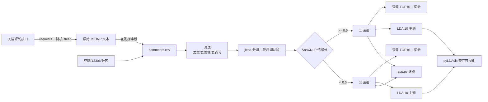

# 05 · 评论文本挖掘与主题聚类（Comments_NLP）

> English version → [README_EN.md](./README_EN.md)

**_把散在评论区里的「好用」「踩雷」扒下来，变成能拿去开会讲的主题。_**

- 主要语言：`Python`
- 主流程：[Tmall_Review_Crawling_and_LDA-Based_Topic_Clustering_Implementation.py](./Tmall_Review_Crawling_and_LDA-Based_Topic_Clustering_Implementation.py)
- 论文项目：[thesis_project/SHU_comments_NLP.py](./thesis_project/SHU_comments_NLP.py)
- 现在在用的采集脚本：[crawler/tmall_crawler.py](./crawler/tmall_crawler.py)（重写版，配置和日志都在里面）
- 速览页：[app.py](./app.py)

---

## 1. 为什么做这个

做线上社区口碑分析的时候，我被问过两个特别朴素的问题：**用户到底在夸什么、在骂什么？**

问题朴素，数据很麻烦：评论是纯文本，散在电商详情页、社区帖子、论坛楼里，没有现成表可查。所以我按「采集 → 清洗 → 分词 → 分组 → 建模 → 可视化」跑了一遍，中间踩的坑比想象中多。

采集的东西不止一种（顺便练手）：

- 天猫商品评论（主流程用这份）；
- 豆瓣电影 Top250；
- 12306 车次；
- 线上社区用户信息与文本。

## 2. 数据怎么流



## 3. 几个结论

- **噪声必须先清**：不清的话 LDA 出来的主题全是「好评」「宝贝」「物流」这种词，完全没法看。去掉停用词、只留长度 ≥ 2 的词之后，主题才成形；
- **正负面必须分开建模**：混在一起做 LDA，正负语义互相干扰，主题会变得很「中庸」，说不出问题在哪；
- **负面主题比对运营更有用**：正面基本是「香味好闻」「物流快」，负面集中在「头皮痒 / 洗完假滑 / 瓶盖设计 / 漏液」，可以直接对上产品和包装；
- **SnowNLP 只能当粗筛**：遇到「行吧，就这样」「真棒呢」这种反讽，分数会翻车，所以 app 里我把它标成「大概看看」。

## 4. 实测耗时

| 环节 | 数据量 | 耗时 |
| --- | --- | --- |
| 爬 3 页评论（含 3~6 秒随机 sleep） | 60 条 | 约 20 秒 |
| 清洗 + 分词 | 2 万条 | 约 40 秒 |
| SnowNLP 打分 | 2 万条 | 约 3 分钟（单进程，没优化） |
| LDA（10 主题，passes=10） | 正/负各 1 万条 | 约 2 分钟 |
| pyLDAvis 渲染 | — | 约 5 秒 |

## 5. 工程结构

```
05_Comments_NLP/
├── crawler/tmall_crawler.py                     # 采集（config + logging 版）
├── src/text_clean.py                            # 清洗 / 分词 / 情感打分，app 和脚本共用
├── app.py                                       # Streamlit 速览页（几十行）
├── config.example.yaml                          # cookie / 代理 / 翻页数 / 字体路径
├── requirements.txt
├── Dockerfile
├── sample_data/comments_sample.csv              # 30 条我随手编的评论，用来跑通
├── Tmall_Review_Crawling_and_LDA-Based_Topic_Clustering_Implementation.py  # 原始主流程
├── douban_spider.py                             # 豆瓣 Top250
├── rail_tickets_spider.py                       # 12306 车次
├── online_community_userinfo_NLP.py             # 社区用户文本
└── thesis_project/                              # 论文项目（LDA 结果、词云、思维导图）
```

## 6. 怎么跑

```bash
pip install -r requirements.txt
cp config.example.yaml config.yaml      # 填 cookie，不然爬不到

python crawler/tmall_crawler.py         # 采集 → outputs/tmall_comments.csv
streamlit run app.py                    # 打开速览页，默认读样例数据
```

只想看效果不爬虫：直接 `streamlit run app.py`，它读 `sample_data/comments_sample.csv`。

## 7. 踩坑记录 & 妥协方案

**① cookie 半天就过期**
天猫的 cookie 大概几小时就失效，脚本里没做自动刷新（做起来要模拟登录，成本太高）。
现在的做法是：配置里手填，采不到数据时 `fetch_page` 会连着重试两次然后跳过，日志里会写「可能是 cookie 过期」。**很土，但省事。**

**② 免费代理是真的不稳**
一开始用免费代理池，同一个 IP 半小时内必被封，脚本经常跑到第 2 页就没数据。
后来只能加上「随机 sleep 3~6 秒 + 失败重试」，勉强能用。付费代理一直想接，但个人项目实在没必要花钱。

**③ 「机械压缩去词」这段自己把自己坑了**
原始脚本里有一段按字频压缩评论的逻辑，本意是去掉「啊啊啊」这种重复，结果把「稍稍」「刚刚」这类词也压掉了。
现在是直接注释掉不用（原文件里还留着那几行注释，能看到我当时的困惑）。

**④ SnowNLP 在短评论上很不准**
「也就那样」被判成正面，「还行吧」被判成负面。试过自己训一个，标注成本太高，放弃了。
折中方案：`src/text_clean.py` 里留了一个朴素词典兜底，SnowNLP 不可用时至少还能跑。

**⑤ 中文字体路径写死成 Windows 的**
`font_path=r'C:\Windows\Fonts\msyh.ttc'` 在 mac 上直接报错，词云全是方框。
现在字体路径放 config 里，mac 用 `PingFang.ttc`，Docker 里装 `fonts-wqy-zenhei`。

**⑥ pyLDAvis 在 notebook 里渲染不出来**
不是代码问题，是 notebook 版本和 pyLDAvis 的兼容问题。最后导出 `postopic.html` 用浏览器看，反而更方便发给别人。

## 8. 未来打算（TODO）

- [ ] 代理换成付费的，现在免费代理太不稳定，跑一次采集中断两次；
- [ ] 情感分析想换成 BERT 微调版本，SnowNLP 在短文本上确实不够用；
- [ ] 采集脚本现在写死单商品，想改成从配置里读一批 item_id 轮着采；
- [ ] LDA 主题数一直是手动试出来的，想加个困惑度/一致性曲线辅助选 K；
- [ ] 想把 `douban_spider.py` 那些练手脚本挪到 `playground/` 目录，主目录太乱。

## 9. 致谢 / 开发说明

- LDA 流程、清洗规则、情感分组口径和结论是我自己做的（论文项目里跑过更大的语料）；
- `crawler/tmall_crawler.py`、`src/text_clean.py`、`app.py` 是由 Cline 辅助重写的，我在原脚本基础上改了停用词、重试和日志；
- 采集脚本里的 cookie / 代理已全部改成环境变量，仓库里不留凭据；`sample_data` 里的评论是我编的示例，不含真实用户信息；
- 爬虫仅用于个人学习与合规范围内的数据分析，请遵守目标站点的 robots 协议与使用条款。
