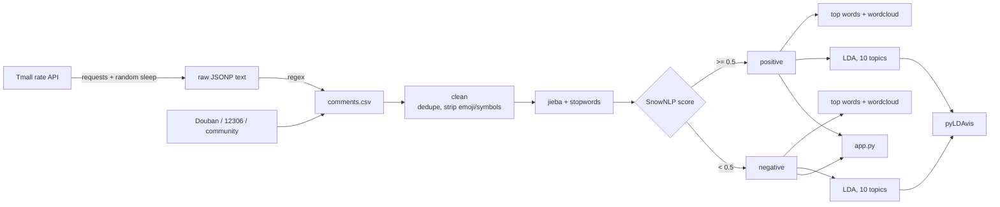

# 05 · Comment Mining and Topic Clustering (Comments_NLP)

> 中文版 → [README.md](./README.md)

**_Pull the "love it / hate it" out of comment sections and turn scattered complaints into themes you can present._**

- Language: `Python`
- Original pipeline: [Tmall_Review_Crawling_and_LDA-Based_Topic_Clustering_Implementation.py](./Tmall_Review_Crawling_and_LDA-Based_Topic_Clustering_Implementation.py)
- Thesis project: [thesis_project/SHU_comments_NLP.py](./thesis_project/SHU_comments_NLP.py)
- Crawler in use now: [crawler/tmall_crawler.py](./crawler/tmall_crawler.py)
- Quick view page: [app.py](./app.py)

---

## 1. Why

While working on community reputation analysis I kept getting one very plain question: **what are users praising, and what are they complaining about?**

Simple question, messy data: comments live in product pages, forum threads and community posts as free text. So I ran the whole chain — collect, clean, tokenise, split, model, visualise — and hit more potholes than expected.

Sources (using several as practice): Tmall product reviews (main), Douban Top250, 12306 train schedules, an online community.

## 2. Data flow



## 3. What came out of it

- **Cleaning is not optional.** Without stopword filtering, every LDA topic is "好评 / 宝贝 / 物流". Keeping only tokens of length >= 2 and a hand-written stoplist made topics readable;
- **Model positives and negatives separately.** Mixed together the topics go bland and you cannot tell what the problem is;
- **Negative topics are the actionable ones.** Positives are basically "smells nice / fast delivery"; negatives cluster into itchy scalp / slippery residue / bad cap design / leaking bottles, which maps straight onto product and packaging;
- **SnowNLP is a coarse filter only.** Sarcasm like "真棒呢" gets scored wrong, so the app labels it "rough" rather than claiming accuracy.

## 4. Timings

| Step | Volume | Time |
| --- | --- | --- |
| Crawl 3 pages (incl. 3–6s random sleep) | 60 comments | ~20s |
| Clean + tokenise | 20k comments | ~40s |
| SnowNLP scoring | 20k comments | ~3 min (single process) |
| LDA (10 topics, passes=10) | 10k per side | ~2 min |
| pyLDAvis render | — | ~5s |

## 5. Layout

```
05_Comments_NLP/
├── crawler/tmall_crawler.py     # collector (config + logging)
├── src/text_clean.py            # clean / tokenise / sentiment, shared by app and scripts
├── app.py                       # tiny Streamlit page
├── config.example.yaml          # cookie, proxy, page count, font path
├── sample_data/comments_sample.csv   # 30 hand-written comments so it runs
└── thesis_project/              # LDA output, wordclouds, mindmap
```

## 6. How to run

```bash
pip install -r requirements.txt
cp config.example.yaml config.yaml      # fill in your cookie
python crawler/tmall_crawler.py         # → outputs/tmall_comments.csv
streamlit run app.py                    # reads the sample data by default
```

## 7. Things that went wrong (and the compromises)

**1) Cookies expire within hours.**
No auto refresh (that means simulating a login, too much work for a personal project). `fetch_page` retries twice, then logs "possibly expired cookie" and moves on. Crude, but it keeps the script moving.

**2) Free proxies are genuinely unstable.**
The free pool gets an IP banned within half an hour, so runs died on page 2. Random 3–6 second sleeps plus retries made it barely usable. A paid proxy is on the TODO list; it is hard to justify for a hobby project.

**3) My own "mechanical compression" step bit me.**
The old script compressed repeated characters by frequency, meant for "啊啊啊", but it also ate "稍稍" and "刚刚". It is commented out now; the comments are still in the original file as a reminder.

**4) SnowNLP is bad on short reviews.**
"也就那样" scores positive, "还行吧" scores negative. Training my own model needs labels I do not have. Compromise: a small lexicon fallback in `src/text_clean.py` so the pipeline still runs when SnowNLP is unavailable.

**5) Font path was hardcoded to Windows.**
`C:\Windows\Fonts\msyh.ttc` fails on macOS and wordclouds render as boxes. Font now lives in config; Docker installs `fonts-wqy-zenhei`.

**6) pyLDAvis will not render in the notebook.**
A notebook/pyLDAvis version mismatch, not my code. Exporting `postopic.html` turned out to be more shareable anyway.

## 8. TODO

- [ ] Move to a paid proxy — free ones drop twice per run;
- [ ] Swap SnowNLP for a fine-tuned BERT; short-text sentiment needs it;
- [ ] The crawler is hardcoded to one item; read a list of `item_id` from config;
- [ ] Topic count K is still eyeballed; add perplexity / coherence curves;
- [ ] Move the practice spiders into `playground/`, the root folder is a mess.

## 9. Credits

The LDA pipeline, cleaning rules, sentiment split and the findings are mine (a larger corpus version lives in the thesis project). `crawler/tmall_crawler.py`, `src/text_clean.py` and `app.py` were rewritten with help from Cline on top of the original script; I adjusted stopwords, retries and logging. Cookies and proxies now come from environment variables, nothing in the repo. Sample comments are synthetic. Crawlers were used for personal learning within the sites' terms.
