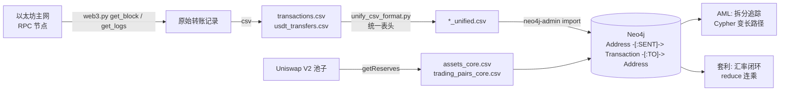

# 06 · 链上反洗钱与套利路径挖掘（Onchain_AML_Arbitrage）

> English version → [README_EN.md](./README_EN.md)

**_地址是点、转账是边，这种数据用 SQL 查多跳会想死，用图数据库刚好。_**

- 主要语言：`Cypher` `Python`
- 核心查询：[neo4j_aml_fanout_ana.cypher](./neo4j_aml_fanout_ana.cypher) · [neo4j_arbitrage_mining.cypher](./neo4j_arbitrage_mining.cypher)
- v2 代码（第 11 节起）：[aml_rule_engine.py](./aml_rule_engine.py) · [arbitrage_optimizer.py](./arbitrage_optimizer.py) · [hedge_sizing.py](./hedge_sizing.py)
- 结果截图：[AML 图谱](./Neo4j_cypher_analysis_AML.png) · [套利路径](./DeFi%20Arbitrage%20Path%20Discovery%20on%20Neo4j.png)

---

## 1. 为什么用图数据库

链上数据天生是图。想回答「这笔脏钱经过几层拆分最后汇到哪」，在 MySQL 里就是连着写四五层 self join，写一次半小时，查一次还得等；Neo4j 里一条变长路径 `[:SENT*1..3]` 就完了。

这个项目做了两个案例：

- **AML**：找出「一个地址转给很多地址」的拆分结构（fan-out），再把两跳之后的资金流向还原出来；
- **套利**：读 Uniswap V2 池子的储备金算实时汇率，在图上找能转回起点的环，扣掉 0.3% 手续费后看还有没有肉。

## 2. 数据怎么流



## 3. 数据规模（示例批次）

| 文件 | 内容 | 规模 |
| --- | --- | --- |
| `nodes_addresses.csv` | 地址节点 | 约 56,286 个 |
| `transactions.csv` | 原生转账关系 | 约 73,876 条 |
| `usdt_addresses.csv` | USDT 地址节点 | 约 1,251 个 |
| `usdt_transfers.csv` | USDT Transfer 事件 | 约 1,037 条 |
| `assets_core.csv` / `trading_pairs_core.csv` | 核心代币与汇率关系 | 10 个池子 |

配套 `*_unified.csv` 是统一表头后的版本，`value:string` + `block_number:int`。

## 4. 两个案例的结论

**AML**

- fan-out 查询能直接排出「可疑地址 → 中间地址」的拆分层级，实测样本里最多一个中间地址转给了 17 个下游；
- 两跳路径能把「拆散的钱」重新拼回几组，配合 fan-out 数量基本可以人工判断是不是在拆；
- `aml_analysis.py` 把三条查询串起来，换个地址就能跑。

**套利**

- `USDC → WETH → WBTC → USDC` 三跳，`finalAmount ≈ 1.001377`，扣 0.3% 手续费后净收益约 0.1377%；
- 空间很薄，但这就是 MEV 机器人的目标区间 —— 人工是抢不到的，结论是「不适合手动套利」，这本身也是个有用的结论；
- 顺手做了汇率一致性校验（A→B→A 应该 ≈ 1），**正是这个校验发现我抄错了两个池子地址**。

## 5. 性能（本地单机）

| 环节 | 规模 | 耗时 |
| --- | --- | --- |
| 导出 1,000 个区块的原生转账 | 73,876 条关系 | 约 7 分钟（受 RPC 限制） |
| 导出 10 个区块的 USDT Transfer | 1,037 条 | 约 8 秒 |
| `neo4j-admin import` 批量导入 | 5 万多节点 | 约 30 秒 |
| 三跳套利路径查询 | 10 个池子 | 0.2 秒以内 |
| fan-out 查询 | 5 万节点 | 1 秒左右 |

## 6. 工程结构

```
06_Onchain_AML_Arbitrage/
├── config_loader.py             # 统一的配置/日志入口（RPC、Neo4j 都从这读）
├── config.example.yaml          # 区块范围、输出文件名、池子 sleep 间隔
├── .env.example                 # RPC_URL / NEO4J_PASSWORD
├── docker-compose.yml           # 本地 Neo4j 5
├── export_transactions.py       # 原生转账 → CSV
├── export_erc20_to_csv.py       # USDT Transfer 事件 → CSV
├── export_erc20.py              # 调试版（功能重复，留着备查）
├── unify_csv_format.py          # 统一表头，适配 neo4j-admin import
├── aml_analysis.py              # 可疑地址三连分析
├── aml_tracing.py               # 连接 smoke test
├── fetch_uniswap_rates.py       # 读池子储备金算汇率
├── neo4j_aml_fanout_ana.cypher  # AML 查询
├── neo4j_arbitrage_mining.cypher # 套利查询
└── *.csv / *.png                # 导入数据与结果截图
```

## 7. 怎么跑

```bash
cp .env.example .env            # 填 RPC_URL 和 Neo4j 密码
docker compose up -d            # Neo4j：7474 / 7687
pip install -r requirements.txt

python export_transactions.py        # 先导一小段区块试试
python unify_csv_format.py           # 统一表头
# 导入（容器里执行，CSV 已经挂到 /import）
docker exec -it onchain_neo4j neo4j-admin database import full neo4j \
  --nodes=/import/nodes_addresses_fixed.csv \
  --relationships=/import/transactions_unified.csv

python aml_analysis.py               # 换 config 里的 suspect_address 即可
python fetch_uniswap_rates.py        # 套利用的汇率
```

## 8. 踩坑记录 & 妥协方案

**① Infura 免费额度被打爆**
免费版一天 10 万次请求，我一开始想扫全链，跑了半小时就被限流，返回一堆 429。
后来两个办法：只导指定区块区间；每次 RPC 调用之间 `sleep(0.2)`。很慢，但不用付费。

**② `get_logs` 一次最多 10000 条**
USDT 这种高频合约，10 个区块就能超。脚本里加了个判断，把提示直接打出来（"缩小区块范围"），免得下次又踩。

**③ value 用 `long` 导入直接溢出**
Wei 是 18 位小数，大额转账超过 Java long 的范围，`neo4j-admin import` 报错但错误信息很不直观，排查了半天。
改成 `value:string` 就好了。`unify_csv_format.py` 这个脚本就是为这件事写的 —— 其实就是为了改个表头，专门写个脚本有点傻，但比重导一遍省事。

**④ Neo4j import 对表头极其严格**
表头列名、列顺序、类型后缀，任何一处不一致都会整批失败，而且报错只说哪一行，不说哪一列。
这也是为什么会有 `*_unified.csv` 和 `*_fixed.csv` 两套文件 —— 文件名难看，但省了我重新造数据。

**⑤ 池子地址抄错两个**
`WETH-UNI`、`WETH-LINK` 的池子地址第一次是从某篇博客抄的，早就失效了。
发现方式很偶然：做汇率一致性校验时，A→B→A 连乘出来是 0.7 而不是 1，说明地址错了。改完之后全部 ≈ 1.0。

**⑥ `0xSuspicious001` 是我编的地址**
示例数据里的可疑地址是造的，不是真实案件。真实分析时把 `config.yaml` 里的 `suspect_address` 换成链上地址即可。

**⑦ 之前 Infura 的 key 明文写在五个脚本里**
push 前自查发现的，已经轮换，现在统一从 `.env` 读，仓库里搜不到 key。

## 9. 未来打算（TODO）

- [ ] RPC 还是用免费额度，想接一个付费节点（Alchemy），扫全链就不会被限流；
- [ ] 导入方式想从「整库重导」改成增量，现在每次加新数据都要重建一次库；
- [ ] Cypher 里的地址还是半硬编码，想全部参数化，做成 `--address` 传参；
- [ ] 套利只看了 Uniswap V2，V3 的集中流动性算起来完全不一样，暂时不敢碰；
- [ ] 想给每个区块加时间戳属性，现在只能靠块高估时间，查起来不方便。

## 10. 致谢 / 开发说明

- Cypher 查询、两跳追踪思路、套利收益计算（含手续费）是从0到1搭建并实际验证过策略和逻辑都是确确实实能有Profit的；
- `config_loader.py`、`docker-compose.yml`、`unify_csv_format.py` 的思路骨架伪代码由Agent辅助生成，而后我在此基础上丰富；
- 脚本里的 RPC / 密码已全部改为环境变量，示例地址和密钥均为占位符；数据来源是以太坊公开链上数据。

---

## 11. v2 深化：从「能查出结构」到「能解释风险、能算清成本」

> 这一部分是**叠加在 v1（含 config_loader / docker-compose 那一版）之上的一层**：v1 的 Cypher、脚本与踩坑记录全部保留，
> v2 只是补上两个在真实业务里躲不开的问题：
>
> 1. **反洗钱**：一条「fan-out 查询」只能算线索，不能算结论。真实合规流程要有**规则库 + 风险评分 + 证据链 + 处置清单**，并且规则要能从 Python 复现到 Cypher。
> 2. **套利**：把汇率连乘得到 `finalAmount = 1.001377`，是**纸面套利**（隐含「无限小仓位、手续费最后统一扣」）。真实执行要回答三件事：**能塞多大仓位（价格冲击）**、**gas/闪贷/tip 吃掉多少**、**非原子执行时要不要在永续上对冲**。
>
> v2 新增的 6 个模块里，除 `fetch_uniswap_reserves.py` 复用 v1 已有的 `web3` 依赖外，其余 5 个**只依赖 Python 标准库**（`csv/json/math/statistics`）；`bash run_all.sh` 一键复现，30 个单元测试全部通过。

### 11.1 v2 新增能力总览

| 方向 | v1 能做到 | v2 新增 | 主要文件 | 产物 |
| --- | --- | --- | --- | --- |
| 反洗钱 | 一条 fan-out Cypher + 三连查询脚本 | 12 条可解释规则、加权风险分（0~100）、5 类图算法、证据链、案例报告、回写 Neo4j | `aml_graph.py`、`aml_rule_engine.py`、`aml_labels.json`、`neo4j_aml_rules.cypher` | `aml_alerts.csv`、`aml_risk_scores.csv`、`aml_case_report.md`、`aml_summary.json` |
| 套利 | 汇率连乘找闭环（线性） | 恒定乘积 AMM 逐跳模拟、**最优仓位求解**（网格+三分）、gas/闪贷/tip 归因、脏数据防线 | `arbitrage_optimizer.py`、`fetch_uniswap_reserves.py`、`neo4j_hedge_arbitrage.cypher` | `arbitrage_opportunities.csv`、`pool_reserves_sample.csv` |
| 对冲 | 无 | Delta 中性对冲成本模型（6 项成本拆解）、成本门槛倒推、216 场景压力测试、资金费 carry | `hedge_sizing.py`、`funding_rates_sample.csv` | `hedge_plan.csv`、`hedge_stress_test.csv`、`carry_analysis.csv` |
| 工程 | 单脚本 | 统一加载器、参数化 CLI、单元测试、一键脚本、依赖收敛 | `tests/`、`run_all.sh`、`requirements.txt` | 30 个测试用例全绿 |

## 12. 反洗钱：从「一条查询」到「可解释的规则引擎」

### 12.1 为什么要加规则层

v1 的 `neo4j_aml_fanout_ana.cypher` 回答的是「A 到 B 之间有几笔转账」，`aml_analysis.py` 回答的是「这个地址转给了多少下游」——都是**单点查询**。真正做合规时会被追问三个问题：

1. **为什么可疑？** → 需要每条命中都带可复核的数字（证据链），而不是一个分数；
2. **严重到什么程度？** → 需要统一的评分口径，否则 10 条告警没法排优先级；
3. **要不要人工介入？会不会误报？** → 需要「缓解因子」（交易所热钱包出度天然很高，不能判成拆分洗钱）。

所以 v2 把可疑行为拆成 12 条独立规则，每条给可解释的权重，最后加权成 0~100 的风险分。

### 12.2 12 条规则（与 `neo4j_aml_rules.cypher` 一一对应）

| 编号 | 规则 | 判定口径（Python / Cypher 同一套阈值） | 权重 | 命中数（ETH / USDT） |
| :---: | --- | --- | :---: | :---: |
| R01 | 拆分转账 FAN_OUT | 单一地址向 ≥ 20（USDT 为 10）个不同地址出账，且金额熵高 | 18 | 115 / 1 |
| R02 | 资金归集 FAN_IN | ≥ 20（USDT 为 10）个不同地址向同一地址打款 | 15 | 163 / 1 |
| R03 | 拆分-归集二部结构 | 「≤2 进 → ≥5 出」（拆分层）或「≥5 进 → ≤2 出」（归集层） | 22 | 133 / 4 |
| R04 | 快进快出 PASS_THROUGH | 进出各 ≥3 笔，且 流出/流入 ∈ [0.85, 1.15]（过账账户 / 跑分号） | 20 | 229 / 4 |
| R05 | 剥洋葱链 PEEL_CHAIN | 每跳主体金额衰减 ≤30%、同时留小额「剥皮」，链长 ≥4 | 25 | 3 / 0 |
| R06 | 粉尘攻击 DUSTING | ≥10 笔粉尘（≤0.0001 ETH / ≤0.01 USDT）覆盖 ≥10 个地址 | 20 | 1 / 4 |
| R07 | 地址投毒 ADDRESS_POISONING | 首 4 位 + 尾 4 位与常用地址相同，且向对方交易对手投过粉尘 | 28 | 233 / 12 |
| R08 | 整数/临界金额 | 反复使用整数单位金额，或卡在申报线下方（如 9,000~10,000 USDT） | 12 | 42 / 2 |
| R09 | 自转 SELF_TRANSFER | 同一地址 ≥2 笔自转（刷量 / 投毒掩护） | 10 | 23 / 0 |
| R10 | 同区块批量出账 | 同一区块内 ≥3 笔出账覆盖 ≥3 个地址（需要 `block_number`） | 15 | 0 / 14 |
| R11 | 高中心度枢纽 | PageRank 前 0.5% 且度数 ≥20（中性信号，权重低） | 8 | 197 / 1 |
| R12 | 实体识别 / 标签 | 命中混币器 +22~24、交易所/合约 −8~−15；或启发式识别服务商地址 −10 | 变量 | 24 / 1 |

评分公式（`aml_rule_engine.score_hits`）：

```
score = clip( Σ 规则权重 + 组合加成 , 0 , 100 )
组合加成 = 5（当同一地址命中 ≥3 条不同规则时）
等级：≥75 严重 / ≥50 高 / ≥30 中 / <30 低
```

三个工程上的细节（都是踩过坑才加的）：

- **去重计分**：同一地址在同一条规则上只算一次，否则 R07 会在「互为一对李鬼」的两个地址之间来回命中两次；
- **缓解因子**：`R12` 支持**负权重**，交易所热钱包 / DEX 路由合约天然扇入扇出极大，靠这一项把误报压下去；
- **标签 ≠ 结论**：`aml_labels.json` 里的名单只是示例，生产环境必须换成内部名单 + OFAC SDN + 商业标签（Chainalysis / TRM / Elliptic），并定期刷新。

### 12.3 实测结果（真实跑出来的数字，可直接复现）

**ETH 数据集**：56,285 个地址 / 73,875 条原生转账（含 184 笔自转，总金额 144,116.84 ETH），全流程约 **3 秒**（纯 Python，无 pandas）。

```
规则命中 1,163 次，覆盖 837 个地址
风险分布：严重 1 / 高 41 / 中 60 / 低 735
```

| 排名 | 地址 | 分数 | 命中规则 | 关键证据（节选） |
| :---: | --- | :---: | --- | --- |
| 1 | `0xf89d7b9c…5eaa40` | 77.3 | R01 R02 R04 R08 R11 R12 | 向 391 个地址出账共 604.18 ETH；132 个地址向其归集 665.28 ETH；留存比 0.91；PageRank 前 0.5%；**同时被识别为疑似服务商地址（−10）** |
| 2 | `0x2bcb6bc6…fad197` | 71.6 | R02 R03 R04 R11 | 归集 + 多进少出 + 快进快出三重叠加 |
| 3 | `0x45300136…92b785` | 70.8 | R01 R02 R04 R08 R11 R12 | 121 进 / 105 出，流入 797.12 → 流出 852.42 ETH |

两个**只有规则引擎才能捞出来**的案例：

- **剥洋葱链（R05）**：从 `0x0c424701…8bc37f` 起手 7.2998 ETH，连续 5 跳：`0x0c42…→0xb805…→0x38d7…→0x05e9…→0x7ecf…→0x48c7…`，每跳都留零头、主体金额单调递减——这是「分层转移 + 抽水」的教科书形态，线性查询看不出来。
- **粉尘投毒组合（R06 + R01）**：`0xae45a824…7b3fca` 向 118 个地址出账，总额只有 **0.0799 ETH**（金额熵 0.95，即每笔都差不多），其中 15 笔是 ≤0.0001 ETH 的粉尘、覆盖 14 个地址。正常账户不会这样花钱，这是典型的「污染交易历史、为地址投毒铺路」。
- **地址投毒（R07）**：ETH 侧命中 233 个地址，全部是「首 4 位 + 尾 4 位相同」的地址指纹碰撞组，且组内存在「向对方交易对手打粉尘」的行为。

**USDT 数据集**：1,250 个地址 / 1,036 条 ERC-20 Transfer（区块 25,910,000–25,910,010），44 次命中 / 32 个地址。

| 排名 | 地址 | 分数 | 命中规则 | 关键证据 |
| :---: | --- | :---: | --- | --- |
| 1 | `0x0889e932…502c9a` | 52.0 | R04 R08 R10 | 流入 **73,189.0290** → 流出 **73,189.0290** USDT（留存比 1.00），7 进 / 9 出，且在同一区块内 3 笔批量出账 |
| 2 | `0x559432e1…e4ed53` | 50.8 | R01 R08 R10 | 51 个收款方 / 20,643.55 USDT；区块 25,910,006 内 22 笔出账覆盖 20 个地址（共 6 个突发区块） |
| 3 | `0x00009d17…b80000` | 35.0 | R06 R10 | 20 笔粉尘覆盖 20 个地址，同一区块批量投递 |

> 注：USDT 侧的「快进快出 + 整数金额 + 同区块批量」是典型的**过账/跑分**特征；它和 ETH 侧的拆分网络在同一个地址空间里可以拼接，这也是把两个数据集放在同一个 Neo4j 库里的价值。

### 12.4 图算法为什么自己写

`aml_graph.py` 实现了 5 个算法，全部纯标准库，5.6 万节点 / 7.4 万边约 2~3 秒：

| 算法 | 用途 | 复杂度 |
| --- | --- | --- |
| PageRank（有向、带悬挂节点重分配） | 找资金枢纽（交易所热钱包、混币器中转、跑分归集户） | O(iter × E) |
| k-core 分解（堆 + 惰性删除） | 剥掉叶子马甲号，优先排查核心层 | O(E log V) |
| 弱连通分量 | 把资金网络切成独立团伙 | O(V + E) |
| Brandes 介数中心性（限定子图 + 抽样） | 找「过桥地址」：拆分网络里真正的关键节点 | O(k × E)，k 为抽样源点数 |
| 剥离链（peel chain） | 沿最大出边走，检测「留零头 + 主体下传」 | O(hops) |

为什么不用 networkx：一是 5.6 万节点用 dict 邻接表就够，二是「自己实现一遍」才能在面试里讲清楚每一步在算什么，三是项目 clone 下来不需要装任何包就能跑。

### 12.5 用法

```bash
# 两个数据集全跑（默认 ETH + USDT），输出告警 / 风险分 / 汇总 / 案例报告
python3 aml_rule_engine.py --top 10

# 只跑 ETH，只要 ≥30 分的地址，并把分数回写 Neo4j
python3 aml_rule_engine.py --datasets ETH --min-score 30 \
  --write-neo4j --neo4j-password "$NEO4J_PASSWORD"
```

产物：

| 文件 | 内容 |
| --- | --- |
| `aml_alerts.csv` | 每条告警：地址、分数、等级、命中规则、`evidence`、`metrics_json`（可复核） |
| `aml_risk_scores.csv` | 地址级风险分，表头可直接被 `LOAD CSV` 消费 |
| `aml_case_report.md` | Top-N 案例卡片 + 每条的复现 Cypher（可直接贴进 Browser） |
| `aml_summary.json` | 本次运行的规则目录、数据集统计、命中分布（保证可复现） |

回写后，所有 Cypher 都能直接按分数过滤：

```cypher
MATCH (a:Address) WHERE a.riskScore >= 50
RETURN a.address, a.riskLevel, a.riskRules ORDER BY a.riskScore DESC;
```

## 13. 套利：从「线性价差」到「AMM 最优仓位」

### 13.1 v1 的 0.1377% 到底意味着什么

v1 的查询是：

```cypher
finalAmount = ∏ rate     // 1 USDC → WETH → WBTC → USDC = 1.001377
```

它隐含了两个不成立的假设：**仓位无限小（无滑点）**、**手续费可以最后统一扣**。（v1 第 4 节写的「扣 0.3% 手续费后净收益约 0.1377%」其实是把**未扣费**的连乘结果当成了净收益；这里不改 v1 原文，只在下面把这一步拆开算清楚。）但 Uniswap V2 的 0.3% 是在**每一跳的输入侧**扣的，三跳就是 `0.997³ ≈ 0.991`，光是手续费就吃掉 0.9%——**13.77 bps 的价差连手续费的零头都不够**。

### 13.2 v2 的算法

```
amount_out = (R_out × amount_in × (1 - fee)) / (R_in + amount_in × (1 - fee))
净利 = 逐跳模拟后的输出 − 本金 − gas − 闪贷费 − builder tip
gas  = (150,000 × 跳数 + 80,000) × gas_price × ETH 价格
```

`arbitrage_optimizer.py` 做四件事：

1. **枚举闭环**：DFS 找 2~4 跳简单环，只保留「起点是环中字典序最小」的规范旋转，并剔除「进出一个池子两次」的伪环；
2. **逐跳 AMM 模拟**：把线性汇率换成恒定乘积，手续费在输入侧扣，价格冲击单独归因（`out/(amount×(1-fee))` 与现货价对比）；
3. **求最优仓位**：净利润关于本金是凹函数（正斜率来自价差、负二次项来自冲击、固定成本把整条曲线下移），先对数网格粗扫、再三分搜索精修；
4. **归因输出**：`linear_edge_bps`（纸面）、`linear_edge_after_fee_bps`（扣费后）、`net_profit_usd`（扣 gas/闪贷/tip）、`price_impact_bps`、`break_even_notional_usd`、`verdict`。

### 13.3 实测结果

数据：`trading_pairs_core.csv` 的 6 个核心池 / 5 个代币 → 12 条闭环（剔除伪环后 6 条）。储备金由汇率反推（`--depth-usd 20000000`，即每个池名义深度 2,000 万美元，标注 `source=derived_from_rates`）。

```
池子 6 个 / 代币 5 个 / 闭环路径 6 条
价格（USDC 锚定）：DAI=0.9993，USDT=0.9986，WBTC=78,464.16，WETH=2,476.77

路径                          线性bps   扣费bps   最优仓位   毛利$    gas$    净利$     结论
USDC>USDT>WETH>USDC            13.77    -76.09        $20   -0.08   33.12   -33.28   NO_EDGE
DAI>WETH>USDC>DAI               7.72    -82.08        $20   -0.08   33.12   -33.29   NO_EDGE
DAI>USDC>USDT>WETH>DAI          6.05   -113.48        $20   -0.11   42.50   -42.73   NO_EDGE
DAI>WETH>USDT>USDC>DAI         -6.04   -125.43        $20   -0.13   42.50   -42.75   NO_EDGE
可执行机会：0 / 6 条
```

**结论（和 v1 完全相反，但这是对的）**：这份快照里没有任何可执行的套利。`USDC>USDT>WETH>USDC` 的 13.77 bps 只是稳定币微偏离造成的纸面价差，扣掉 90 bps 手续费后就是 **−76 bps**，再加价格冲击与 gas，链上净 edge 是 **−141 bps**。

**为什么最优仓位只有 $20？** 因为净利一直是负的，函数单调递减，「最优」自然退化到搜索下界。这恰恰说明一件事：**套利是否存在，不看价差大小，看价差能不能覆盖成本**。

### 13.4 两条数据质量防线（真实踩过的坑）

1. **深度过滤**：`--min-pool-depth-usd`（默认 1 万）剔除垃圾池。用 `trading_pairs_test_50pairs.csv`（50 对测试数据）跑时，会出现 **40,494,447 bps**（40 万倍）的「套利」——那是垃圾币池 / 极端汇率的产物，不是机会；
2. **脏数据标记**：线性价差超过 `--max-sane-edge-bps`（默认 2,000 bps）的环路直接判 `DATA_SUSPECT`，并把该结论一路传到对冲模块（`decision=DATA_SUSPECT`），**不进入交易决策**。

```bash
# 有 RPC：按 v1 的方式配好 .env（RPC_URL），再导出真实储备金
cp .env.example .env            # 填 RPC_URL
python3 fetch_uniswap_reserves.py --out pool_reserves.csv
python3 arbitrage_optimizer.py --reserves pool_reserves.csv --gas-price-gwei 20

# 无 RPC：用 v1 的汇率 CSV 反推名义深度（结果会标注 derived_from_rates）
python3 arbitrage_optimizer.py --from-rates --depth-usd 20000000
```

## 14. 对冲：把「赚价差」变成「赚价差 − 对冲成本」

### 14.1 什么情况下套利需要对冲

| 执行方式 | 是否有敞口 | 是否需要对冲 |
| --- | --- | --- |
| 原子套利（flash loan，一笔交易完成） | 无 | 不需要 |
| 链上买 → 跨链 / CEX 卖（有时滞） | 持有 WETH/WBTC 等波动资产 | **需要**：13 bps 的利润扛不住 1% 的价格波动 |
| 现货-永续基差 / 资金费 carry | 现货多头 | **需要**：用永续空头做成 Delta 中性 |

v1/v2 的套利路径大多属于第二类，所以 v2 加了 `hedge_sizing.py`：**先算链上净 edge，再减对冲成本，最后和门槛比较**。

### 14.2 六项成本拆解（全部换算成 bps）

| 成本项 | 计算方式 | 典型值（$10k 仓位） |
| --- | --- | --- |
| 永续开平仓手续费 | `2 × taker_fee_bps` | 9.0 bps |
| CEX 成交滑点 | 配置项 | 2.0 bps |
| 资金费 | `−funding_8h_bps × 持有小时/8`（做空收资金费时是负成本） | −0.15 bps |
| 基差 | `abs(basis_bps)`（永续溢价的收敛成本） | 3.5 bps |
| 保证金资金成本 | `capital_apr × 持有小时 / 8760` | 0.01 bps |
| 提币固定费 | `withdraw_fee_usd / 仓位 × 1e4` | 0.15 bps |
| **合计** | | **≈ 15.94 bps** |

### 14.3 最有用的一个数：`required_gross_edge_bps`

```
required_gross_edge_bps = 跳数 × 每跳手续费 + 价格冲击 + gas + 闪贷 + tip
                        + 执行缓冲(20bps) + 对冲成本 + 最低净 edge 门槛(5bps)
```

它回答的是「**这笔交易至少要有多大的毛价差才值得做**」。实测（参考仓位 $10,000）：

```
路径                          毛bps    链上净    对冲    对冲后   需毛bps    缺口   决策
USDC>USDT>WETH>USDC           13.77  -141.27   15.94  -157.21   165.97  152.20  REJECT
DAI>WETH>USDC>DAI              7.72  -147.31   15.94  -163.25   165.97  158.25  REJECT
DAI>USDC>USDT>WETH>DAI         6.05  -188.37   15.94  -204.31   205.34  199.29  REJECT
决策分布：EXECUTE=0，WATCH=0，REJECT=6
```

**一句话结论**：三跳套利在这份快照下需要 **166 bps** 的毛价差才值得执行，而市场只给了 **13.77 bps**，缺口 **152 bps**。这就是「看到价差 ≠ 能赚钱」的量化表达。

### 14.4 压力测试：216 个场景，全部为负

对「资金费年化 0/10/30/60% × 基差 −20/0/+20bps × 持有 0.25/1/4 小时 × 滑点 1x/2x」做笛卡尔积（前 3 条最优路径 → 216 组假设）：

```
最差场景 -226.73 bps（funding APR 0%，basis +20bps，持有 4 小时）
最好场景 -154.90 bps（funding APR 60%，basis −20bps，持有 0.25 小时）
净 edge 为正的场景：0 / 216
```

意义：**这个策略对资金费和基差不敏感，因为它的死因是手续费和滑点**。反过来说，如果哪天价差涨到 200 bps，压力测试就能告诉你「在什么 funding / 基差下会翻负」，这才是风控参数该用的东西。

### 14.5 资金费 carry：同一套成本框架的另一种用法

`hedge_sizing.py --mode carry` 把「现货多 + 永续空」的年化收益拆成：资金费年化 − 开平仓手续费年化 − 基差收敛 − 保证金资金成本，并算出 `breakeven_days`（至少持有多久才回本）。

| 资产 | 场所 | 资金费年化 | 基差 | 往返费 | 回本天数 | 净 carry 年化 | 决策 |
| --- | --- | ---: | ---: | ---: | ---: | ---: | :---: |
| SOL | Binance USDT-M | 27.38% | 6.0 bps | 12.0 bps | 2.4 天 | **27.33%** | CARRY |
| ETH | Binance USDT-M | 13.14% | 3.5 bps | 11.0 bps | 4.03 天 | 13.10% | CARRY |
| BTC | Binance USDT-M | 8.76% | 2.0 bps | 10.0 bps | 5.00 天 | 8.72% | CARRY |

> 数据来自 `funding_rates_sample.csv`（**示例值，不是实时行情**）。这部分重点不是数字，而是**同一套「edge − 成本」框架可以同时评价套利、对冲和 carry**，这正是交易台把不同策略放在一张表里比较的方式。

### 14.6 风控参数（脚本里都算出来了）

| 指标 | 含义 | 当前取值 |
| --- | --- | --- |
| `liquidation_buffer_pct` | 强平缓冲 = 1/杠杆 − 维持保证金率 | 3 倍杠杆 → 32.8% |
| `max_holding_hours` | 对冲后净 edge 被资金费 + 资金成本吃光的时间 | 空头收资金费时为 ∞ |
| `hedge_ratio` | 全稳定币路径只做 30% 名义对冲，其余 100% | 1.0 / 0.3 |
| `min_edge_bps` / `min_profit_usd` | 双门槛：既看 bps 也看绝对利润（覆盖运营成本） | 5 bps / $20 |

## 15. 工程化与可复现

### 15.1 v2 文件树（在原目录基础上新增）

```
06_Onchain_AML_Arbitrage/          # v1 的 config_loader.py / docker-compose.yml / .env.example 全部保留，v2 直接复用
├── aml_graph.py                  # v2 图算法库（PageRank / k-core / 介数 / 剥离链 / 连通分量）
├── aml_rule_engine.py            # v2 12 条 AML 规则 + 风险评分 + 案例报告（CLI）
├── aml_labels.json               # v2 标签库（示例，含负权重缓解因子）
├── neo4j_aml_rules.cypher        # v2 规则的 Cypher 版 + 风险分回填 + 调查视角
├── fetch_uniswap_reserves.py     # v2 导出池子储备金（价格冲击的数据来源）
├── arbitrage_optimizer.py        # v2 AMM 模拟 + 最优仓位（网格 + 三分搜索）
├── hedge_sizing.py               # v2 对冲成本模型 + 压力测试 + 资金费 carry
├── neo4j_hedge_arbitrage.cypher  # v2 套利/对冲的图模型与查询
├── funding_rates_sample.csv      # v2 永续资金费样本（示例）
├── requirements.txt              # v1 依赖清单 + v2 注释（v2 模块基本零依赖）
├── run_all.sh                    # 一键复现
└── tests/
    ├── test_aml_rules.py         # 图算法 + 规则 + 评分（13 个用例）
    └── test_arbitrage.py         # AMM + 环路 + 优化器 + 对冲 + carry（17 个用例）
```

### 15.2 一键跑通

```bash
cd projects/06_Onchain_AML_Arbitrage
bash run_all.sh          # 规则引擎 → 套利优化 → 对冲决策 → carry → 单元测试
```

单步命令：

```bash
python3 aml_rule_engine.py --top 10
python3 arbitrage_optimizer.py --from-rates --depth-usd 20000000 --top 6
python3 hedge_sizing.py --stress
python3 hedge_sizing.py --mode carry
python3 -m unittest discover -s tests -v      # 30 个用例，全部通过
```

### 15.3 依赖策略

v2 的 5 个模块（`aml_graph.py` / `aml_rule_engine.py` / `arbitrage_optimizer.py` / `hedge_sizing.py` 及 `tests/`）**零第三方依赖**（`csv/json/math/statistics/unittest`）；只有 `fetch_uniswap_reserves.py` 需要 v1 已有的 `web3`，并会自动复用 v1 的 `config_loader` 去读 `.env` / `config.yaml`。`requirements.txt` 保持 v1 那份不变，只补了注释说明哪些是 v2 会用到。这样做很实际：面试官 clone 下来 30 秒内就能跑出结果，而不必先装 300MB 的 pandas + web3。

## 16. 局限与下一步

**已知局限（写在前面，避免过度解读）**

1. **没有时间戳**：原生转账 CSV 只导出了 `from/to/value/hash`，没有 block_number 与 timestamp，所以 R10 在 ETH 侧命中为 0，也没法做「速度型」规则（如 10 分钟内拆成 20 笔）。USDT 侧有区块号，因此 R10 生效；补齐区块号后 ETH 侧会重新命中；
2. **储备金是快照**：`pool_reserves_sample.csv` 由汇率反推名义深度（`source=derived_from_rates`），只能验证计算链路，不能当真实流动性；真实分析请用 `fetch_uniswap_reserves.py`；
3. **未建模区块内竞争**：没有考虑 MEV 抢跑、私池、同区块其他机器人把价差吃掉，也没有考虑 Nonce 失败率；
4. **对冲成本是静态假设**：CEX 费率分档、借币成本、资金费历史波动都没有建模，只做了压力测试区间；
5. **标签库是示例**：`aml_labels.json` 只含公开可查的基础设施/混币器地址，真实合规必须接商业名单或官方制裁名单；
6. **不接实盘**：全流程是 paper trading（离线计算 + 决策输出），没有任何下单代码——这是刻意的。

**下一步（按价值排序）**

- [ ] 补齐 `block_number / block_timestamp`，把「速度型」规则（同块批量、短时窗口拆分）在 ETH 侧也跑起来；
- [ ] 用 `eth_getLogs` 拉取真实 Swap 事件，把 AMM 模拟换成「真实成交价 vs 理论价」的回测；
- [ ] 引入 GDS（Louvain 社区发现 + Node Similarity）做团伙识别，替代现在的弱连通分量近似；
- [ ] 把 `hedge_plan.csv` 接到实盘风控：仓位上限、敞口监控、异常告警；
- [ ] 对冲成本改为从交易所 API 实时拉取（资金费、深度、费率档位），并做滚动回测。
