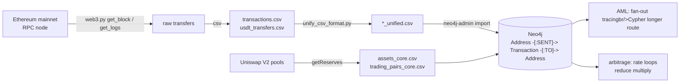

# 06 · On-chain AML and Arbitrage Path Mining (Onchain_AML_Arbitrage)

> 中文版 → [README.md](./README.md)

**_Addresses are nodes, transfers are edges. Multi-hop queries in SQL are painful; in a graph database they are the point._**

- Language: `Cypher` `Python`
- Core queries: [AML fan-out](./neo4j_aml_fanout_ana.cypher) · [arbitrage mining](./neo4j_arbitrage_mining.cypher)
- v2 code (from section 11): [aml_rule_engine.py](./aml_rule_engine.py) · [arbitrage_optimizer.py](./arbitrage_optimizer.py) · [hedge_sizing.py](./hedge_sizing.py)
- Screenshots: [AML graph](./Neo4j_cypher_analysis_AML.png) · [arbitrage path](./DeFi%20Arbitrage%20Path%20Discovery%20on%20Neo4j.png)

---

## 1. Why a graph database

On-chain data is a graph. "Where did this money end up after being split four times" is four self-joins in MySQL (half an hour to write, then you wait), and one variable-length pattern `[:SENT*1..3]` in Neo4j.

Two cases in this project:

- **AML**: find fan-out structures (one address paying many), then reconstruct where funds land two hops later;
- **Arbitrage**: read Uniswap V2 reserves, compute live rates, find closed loops in the graph, and check whether anything is left after the 0.3% fee.

## 2. Data flow




## 3. Data volume (sample batch)

| File | Content | Size |
| --- | --- | --- |
| `nodes_addresses.csv` | address nodes | ~56,286 |
| `transactions.csv` | native transfers | ~73,876 |
| `usdt_addresses.csv` | USDT address nodes | ~1,251 |
| `usdt_transfers.csv` | USDT Transfer events | ~1,037 |
| `assets_core.csv` / `trading_pairs_core.csv` | tokens and rates | 10 pools |

## 4. What the two cases showed

**AML**

- The fan-out query ranks intermediate addresses directly; in this sample one intermediate address paid 17 distinct downstream addresses;
- Two-hop paths let you regroup the split money, and fan-out count plus receiver overlap is usually enough to eyeball whether someone is structuring;
- `aml_analysis.py` chains the three queries so switching address is one config change.

**Arbitrage**

- `USDC → WETH → WBTC → USDC` gives `finalAmount ≈ 1.001377`; after 0.3% per hop the net is about 0.1377%;
- Thin, but that is exactly the MEV bots' hunting range — the honest conclusion is "not a manual trade";
- I also ran a rate consistency check (A→B→A should be ≈ 1), **which is how I found two pool addresses I had copied from a blog were wrong**.

## 5. Performance (local, single machine)

| Step | Volume | Time |
| --- | --- | --- |
| Export 1,000 blocks of native transfers | 73,876 edges | ~7 min (RPC bound) |
| Export 10 blocks of USDT transfers | 1,037 | ~8s |
| `neo4j-admin import` | 50k+ nodes | ~30s |
| Three-hop arbitrage query | 10 pools | < 0.2s |
| Fan-out query | 50k nodes | ~1s |

## 6. Layout

```
06_Onchain_AML_Arbitrage/
├── config_loader.py              # single entry for config + logging
├── config.example.yaml           # block range, output names, pool sleep
├── .env.example                  # RPC_URL / NEO4J_PASSWORD
├── docker-compose.yml            # local Neo4j 5
├── export_transactions.py        # native transfers → CSV
├── export_erc20_to_csv.py        # USDT Transfer events → CSV
├── export_erc20.py               # debug version, kept for reference
├── unify_csv_format.py           # header normalisation for neo4j-admin import
├── aml_analysis.py               # the three AML queries
├── aml_tracing.py                # connection smoke test
├── fetch_uniswap_rates.py        # reserves → rates
└── *.cypher                      # the actual analysis
```

## 7. How to run

```bash
cp .env.example .env && docker compose up -d
pip install -r requirements.txt
python export_transactions.py
python unify_csv_format.py
docker exec -it onchain_neo4j neo4j-admin database import full neo4j \
  --nodes=/import/nodes_addresses_fixed.csv --relationships=/import/transactions_unified.csv
python aml_analysis.py
python fetch_uniswap_rates.py
```

## 8. Things that went wrong (and the compromises)

**1) Infura free tier ran out.**
100k requests/day; trying to scan the whole chain got me 429s within half an hour. Fixes: export narrow block ranges only, and `sleep(0.2)` between RPC calls. Slow, free.

**2) `get_logs` caps at 10,000 results.**
USDT alone blows past that in 10 blocks. The script now prints the actual hint ("shrink the range") so future-me does not debug it again.

**3) `value` as `long` overflowed on import.**
Wei has 18 decimals, large transfers exceed Java long, and the import error message does not say which column. Switched to `value:string`. `unify_csv_format.py` exists because of this — a whole script to patch headers, a bit silly, but cheaper than re-exporting.

**4) The importer is unforgiving about headers.**
Column names, order and type suffixes must match exactly; a mismatch fails the whole batch and the error only names the row. Hence the `*_unified.csv` and `*_fixed.csv` copies — ugly filenames, saved me from regenerating data.

**5) Two pool addresses were wrong.**
`WETH-UNI` and `WETH-LINK` came from an old blog post. Found it by accident: the A→B→A consistency check returned 0.7 instead of 1. After fixing, everything is ≈ 1.0.

**6) `0xSuspicious001` is a made-up address.**
The sample suspect address is synthetic, not a real case. Point `suspect_address` in `config.yaml` at a real address to rerun.

**7) The Infura key used to be hardcoded in five scripts.**
Caught during a pre-push review, rotated, and everything now reads from `.env`. A grep for the old key returns nothing.

## 9. TODO

- [ ] Move to a paid RPC (Alchemy) so full-chain scans stop getting throttled;
- [ ] Incremental import instead of rebuilding the database each time;
- [ ] Fully parameterise Cypher, `--address` on the command line instead of config edits;
- [ ] Only Uniswap V2 so far; V3 concentrated liquidity changes the maths completely, not touching it yet;
- [ ] Add a block timestamp property; estimating time from block height is awkward.

## 10. Credits

The Cypher queries, the two-hop tracing approach and the fee-adjusted arbitrage maths are mine and validated. `config_loader.py`, `docker-compose.yml` and the `unify_csv_format.py` skeleton were drafted with Cline and adapted to the real CSV headers. All keys and passwords are environment variables now; sample addresses are placeholders; data comes from public Ethereum on-chain records.

---

## 11. v2 deep dive: from "finding structure" to "explaining risk and costing execution"

> This part is **layered on top of v1 (including the config_loader / docker-compose revision)** — every v1 Cypher query, script and pitfall note is kept.
> v2 only fills in two gaps that show up the moment you try to use the analysis for real decisions:
>
> 1. **AML**: one fan-out query is a lead, not a conclusion. A real compliance workflow needs a **rule library + risk score + evidence trail + disposition list**, and the rules must be reproducible in both Python and Cypher.
> 2. **Arbitrage**: multiplying rates to get `finalAmount = 1.001377` is **paper arbitrage** — it assumes an infinitely small position and that fees are charged once at the end. Real execution has to answer three questions: **how large a position fits (price impact)**, **how much gas / flash-loan fee / builder tip eats**, and **whether a non-atomic execution needs a perp hedge**.
>
> Of the 6 new modules, only `fetch_uniswap_reserves.py` reuses the existing `web3` dependency; the other 5 are **pure Python standard library** (`csv/json/math/statistics`). `bash run_all.sh` reproduces everything and all 30 unit tests pass.

### 11.1 What's new in v2

| Direction | v1 capability | v2 addition | Main files | Outputs |
| --- | --- | --- | --- | --- |
| AML | one fan-out Cypher + a three-part query script | 12 explainable rules, weighted 0–100 risk score, five graph algorithms, evidence trail, case report, write-back to Neo4j | `aml_graph.py`, `aml_rule_engine.py`, `aml_labels.json`, `neo4j_aml_rules.cypher` | `aml_alerts.csv`, `aml_risk_scores.csv`, `aml_case_report.md`, `aml_summary.json` |
| Arbitrage | linear rate product over closed loops | constant-product AMM simulation per hop, **optimal position sizing** (grid + ternary search), gas/flash-loan/tip attribution, dirty-data guardrails | `arbitrage_optimizer.py`, `fetch_uniswap_reserves.py`, `neo4j_hedge_arbitrage.cypher` | `arbitrage_opportunities.csv`, `pool_reserves_sample.csv` |
| Hedging | — | delta-neutral hedge cost model (6 components), required-edge back-solve, 216-scenario stress test, funding carry | `hedge_sizing.py`, `funding_rates_sample.csv` | `hedge_plan.csv`, `hedge_stress_test.csv`, `carry_analysis.csv` |
| Engineering | one-off scripts | unified loader, parameterised CLI, unit tests, one-shot script, dependency diet | `tests/`, `run_all.sh`, `requirements.txt` | 30 passing test cases |

## 12. AML: from a single query to an explainable rule engine

### 12.1 Why a rule layer

`neo4j_aml_fanout_ana.cypher` answers "how many transfers are there between A and B"; `aml_analysis.py` answers "how many downstream addresses does this address pay". Both are **single-point lookups**. In a real compliance review you get asked three questions:

1. **Why is it suspicious?** → every hit needs reviewable numbers (an evidence trail), not just a score;
2. **How bad is it?** → without a common scoring scale, 10 alerts cannot be prioritised;
3. **Will this create false positives?** → you need **mitigating factors** (an exchange hot wallet naturally has a huge out-degree; that is not structuring).

So v2 splits suspicious behaviour into 12 independent rules, gives each an explainable weight, and combines them into a 0–100 score.

### 12.2 The 12 rules (mirrored 1:1 in `neo4j_aml_rules.cypher`)

| ID | Rule | Detection logic (same thresholds in Python and Cypher) | Weight | Hits (ETH / USDT) |
| :---: | --- | --- | :---: | :---: |
| R01 | Fan-out splitting | one address pays ≥ 20 (10 for USDT) distinct receivers with high amount entropy | 18 | 115 / 1 |
| R02 | Fan-in consolidation | ≥ 20 (10 for USDT) distinct senders pay the same address | 15 | 163 / 1 |
| R03 | Split-then-merge | "≤2 in → ≥5 out" (split layer) or "≥5 in → ≤2 out" (collection layer) | 22 | 133 / 4 |
| R04 | Pass-through / mule | ≥3 in and ≥3 out, and out/in value ∈ [0.85, 1.15] | 20 | 229 / 4 |
| R05 | Peel chain | each hop keeps only a small peel (≤20%) while the main amount decays ≤30%, chain length ≥4 | 25 | 3 / 0 |
| R06 | Dusting attack | ≥10 dust transfers (≤0.0001 ETH / ≤0.01 USDT) to ≥10 distinct addresses | 20 | 1 / 4 |
| R07 | Address poisoning | same first-4 + last-4 hex fingerprint as a legit address, and dusts that address's counterparties | 28 | 233 / 12 |
| R08 | Round / just-below-threshold amounts | repeated round-unit amounts, or amounts just under a reporting band (e.g. 9,000–10,000 USDT) | 12 | 42 / 2 |
| R09 | Self transfer | ≥2 self transfers (volume padding / poisoning cover) | 10 | 23 / 0 |
| R10 | Same-block burst | ≥3 outbound transfers to ≥3 addresses in one block (needs `block_number`) | 15 | 0 / 14 |
| R11 | Hub centrality | PageRank top 0.5% and degree ≥20 (a neutral signal, low weight) | 8 | 197 / 1 |
| R12 | Labeled entity | mixers +22~24, exchanges/contracts −8~−15, or heuristic service-address mitigation −10 | variable | 24 / 1 |

Scoring (`aml_rule_engine.score_hits`):

```
score = clip( sum(rule weights) + stack bonus , 0 , 100 )
stack bonus = 5 when an address hits >= 3 distinct rules
bands: >=75 critical / >=50 high / >=30 medium / <30 low
```

Three engineering details that only appear after real use:

- **dedupe before scoring**: one address scores at most once per rule — otherwise R07 hits twice when two spoofing addresses point at each other;
- **mitigating factors**: `R12` supports **negative weights**, so exchange hot wallets and DEX routers (which naturally have massive fan-in/fan-out) are pushed down instead of being flagged as money laundering;
- **labels ≠ conclusions**: the list in `aml_labels.json` is illustrative; production must use internal lists + OFAC SDN + commercial labels (Chainalysis / TRM / Elliptic) and refresh them regularly.

### 12.3 Measured results (reproducible numbers)

**ETH dataset**: 56,285 addresses / 73,875 native transfers (including 184 self transfers, 144,116.84 ETH total), full run **~3 seconds** (pure Python, no pandas).

```
1,163 rule hits over 837 addresses
risk bands: critical 1 / high 41 / medium 60 / low 735
```

| # | Address | Score | Rules hit | Key evidence (excerpt) |
| :---: | --- | :---: | --- | --- |
| 1 | `0xf89d7b9c…5eaa40` | 77.3 | R01 R02 R04 R08 R11 R12 | pays 391 addresses (604.18 ETH); 132 senders consolidate 665.28 ETH; retention 0.91; PageRank top 0.5%; **also flagged as a likely service address (−10)** |
| 2 | `0x2bcb6bc6…fad197` | 71.6 | R02 R03 R04 R11 | consolidation + many-in/few-out + pass-through stacked |
| 3 | `0x45300136…92b785` | 70.8 | R01 R02 R04 R08 R11 R12 | 121 in / 105 out, 797.12 in → 852.42 ETH out |

Two cases that **only the rule engine surfaces**:

- **Peel chain (R05)**: from `0x0c424701…8bc37f`, starting with 7.2998 ETH over 5 hops — `0x0c42…→0xb805…→0x38d7…→0x05e9…→0x7ecf…→0x48c7…` — each hop keeps a peel and the main amount decays monotonically. Textbook layering; a linear query cannot see it.
- **Dust + fan-out combo (R06 + R01)**: `0xae45a824…7b3fca` pays 118 addresses with a **total of 0.0799 ETH** (amount entropy 0.95 — every ticket is nearly equal), 15 of which are ≤0.0001 ETH dust covering 14 addresses. No normal account spends like this; it is transaction-history pollution preparing for address poisoning.
- **Address poisoning (R07)**: 233 addresses on the ETH side are all "first-4 + last-4" fingerprint collision groups, with dust sent to the other member's counterparties.

**USDT dataset**: 1,250 addresses / 1,036 ERC-20 Transfer events (blocks 25,910,000–25,910,010), 44 hits over 32 addresses.

| # | Address | Score | Rules hit | Key evidence |
| :---: | --- | :---: | --- | --- |
| 1 | `0x0889e932…502c9a` | 52.0 | R04 R08 R10 | **73,189.0290 in → 73,189.0290 out** USDT (ratio 1.00), 7 in / 9 out, plus a 3-transfer burst in one block |
| 2 | `0x559432e1…e4ed53` | 50.8 | R01 R08 R10 | 51 receivers / 20,643.55 USDT; 22 outbound transfers to 20 addresses in block 25,910,006 (6 burst blocks) |
| 3 | `0x00009d17…b80000` | 35.0 | R06 R10 | 20 dust transfers to 20 addresses in the same block |

> Note: the USDT "pass-through + round amounts + same-block burst" pattern is a classic mule / settlement-account signature. Because both datasets share the same `:Address` label, the two views can be joined in one Neo4j database.

### 12.4 Why the graph algorithms are hand-rolled

`aml_graph.py` implements 5 algorithms with the standard library only; 56k nodes / 74k edges run in ~2–3 seconds:

| Algorithm | Purpose | Complexity |
| --- | --- | --- |
| PageRank (directed, dangling mass redistributed) | find funding hubs (exchange hot wallets, mixer relays, settlement accounts) | O(iter × E) |
| k-core decomposition (heap + lazy delete) | peel off leaf mule accounts, triage the core first | O(E log V) |
| Weakly connected components | cut the network into independent cells | O(V + E) |
| Brandes betweenness (restricted subgraph + sampling) | find bridge addresses, the real key nodes in a split network | O(k × E), k = sampled sources |
| Peel chain | follow the largest out-edge, detect "peel + forward" | O(hops) |

Why not networkx: a dict adjacency list is enough for 56k nodes; implementing it makes every step explainable; and the repo runs with zero installs.

### 12.5 Usage and outputs

```bash
# both datasets (default ETH + USDT): alerts / risk scores / summary / case report
python3 aml_rule_engine.py --top 10

# ETH only, keep >=30, write scores back to Neo4j
python3 aml_rule_engine.py --datasets ETH --min-score 30 \
  --write-neo4j --neo4j-password "$NEO4J_PASSWORD"
```

| File | Content |
| --- | --- |
| `aml_alerts.csv` | one row per address: score, level, rules, `evidence`, `metrics_json` |
| `aml_risk_scores.csv` | address-level scores, header ready for `LOAD CSV` |
| `aml_case_report.md` | top-N case cards plus a reproduction Cypher per case |
| `aml_summary.json` | rule catalogue, dataset stats, hit distribution (for reproducibility) |

Once written back, any Cypher can filter by score:

```cypher
MATCH (a:Address) WHERE a.riskScore >= 50
RETURN a.address, a.riskLevel, a.riskRules ORDER BY a.riskScore DESC;
```

## 13. Arbitrage: from linear spread to AMM-optimal size

### 13.1 What v1's 0.1377% really means

v1 computes:

```cypher
finalAmount = ∏ rate     // 1 USDC → WETH → WBTC → USDC = 1.001377
```

That formula hides two assumptions that do not hold: **the position is infinitely small (no slippage)** and **fees can be deducted once at the end**. (The “~0.1377% net after the 0.3% fee” line in v1 section 4 actually took the **pre-fee** product as net profit. v1’s wording is left untouched; the split is spelled out below.) Uniswap V2 charges 0.3% on the **input side of every hop**; three hops give `0.997³ ≈ 0.991`, so the fee alone eats 0.9% — a 13.77 bps spread is not even a tenth of the fee.

### 13.2 The v2 algorithm

```
amount_out = (R_out × amount_in × (1 - fee)) / (R_in + amount_in × (1 - fee))
net = output after all hops − principal − gas − flash-loan fee − builder tip
gas = (150,000 × hops + 80,000) × gas_price × ETH price
```

`arbitrage_optimizer.py` does four things:

1. **Enumerate closed loops**: DFS over 2–4 hop simple cycles, keep only the canonical rotation (start = lexicographically smallest symbol), and drop pseudo-loops that enter and leave the same pool;
2. **Per-hop AMM simulation**: constant product instead of linear rates, fee on the input side, price impact attributed separately (`out/(amount×(1-fee))` vs spot);
3. **Solve for the optimal size**: net profit is concave in notional (positive slope from the edge, negative quadratic from impact, fixed costs shift the whole curve down) — coarse log grid then ternary refinement;
4. **Attributed output**: `linear_edge_bps` (paper), `linear_edge_after_fee_bps`, `net_profit_usd` (after gas/fee/tip), `price_impact_bps`, `break_even_notional_usd`, `verdict`.

### 13.3 Measured results

Data: 6 core pools / 5 tokens from `trading_pairs_core.csv` → 12 closed loops (6 after removing pseudo-loops). Reserves are derived from the v1 rates (`--depth-usd 20000000`, i.e. a nominal $20M depth per pool, tagged `source=derived_from_rates`).

```
pools 6 / tokens 5 / cycles 6
USD prices (USDC anchored): DAI=0.9993, USDT=0.9986, WBTC=78,464.16, WETH=2,476.77

path                          linear bps  after fee  optimal   gross$   gas$    net$     verdict
USDC>USDT>WETH>USDC                13.77     -76.09      $20    -0.08  33.12  -33.28   NO_EDGE
DAI>WETH>USDC>DAI                   7.72     -82.08      $20    -0.08  33.12  -33.29   NO_EDGE
DAI>USDC>USDT>WETH>DAI              6.05    -113.48      $20    -0.11  42.50  -42.73   NO_EDGE
DAI>WETH>USDT>USDC>DAI             -6.04    -125.43      $20    -0.13  42.50  -42.75   NO_EDGE
executable: 0 / 6
```

**Conclusion (the opposite of v1, and the correct one)**: there is no executable arbitrage in this snapshot. The 13.77 bps on `USDC>USDT>WETH>USDC` is just a stablecoin micro-deviation; after the 90 bps of fees it is **−76 bps**, and with impact and gas the on-chain net edge is **−141 bps**.

**Why is the "optimal" size only $20?** Because net profit is negative everywhere and monotonically decreasing, so the optimum degenerates to the lower search bound. That is the point: **whether arbitrage exists is not a question about the spread, it is a question about whether the spread covers the cost**.

### 13.4 Two data-quality guardrails (learned the hard way)

1. **Depth filter**: `--min-pool-depth-usd` (default $10k) removes junk pools. Running `trading_pairs_test_50pairs.csv` (the 50-pair test set) produces a **40,494,447 bps** (400,000×) "arbitrage" — that is a junk token pool / broken price, not an opportunity;
2. **Dirty-data flag**: any loop whose linear edge exceeds `--max-sane-edge-bps` (default 2,000 bps) is marked `DATA_SUSPECT`, and that verdict propagates into the hedge module (`decision=DATA_SUSPECT`) so it **never reaches a trading decision**.

```bash
# with RPC: configure .env the v1 way (RPC_URL), then export real reserves
cp .env.example .env            # fill in RPC_URL
python3 fetch_uniswap_reserves.py --out pool_reserves.csv
python3 arbitrage_optimizer.py --reserves pool_reserves.csv --gas-price-gwei 20

# without RPC: derive nominal depth from the v1 rate CSV (tagged derived_from_rates)
python3 arbitrage_optimizer.py --from-rates --depth-usd 20000000
```

## 14. Hedging: from "earn the spread" to "earn the spread minus hedge cost"

### 14.1 When an arbitrage needs a hedge

| Execution style | Exposure | Hedge needed? |
| --- | --- | --- |
| Atomic (flash loan, one transaction) | none | no |
| Buy on-chain → sell on another chain / CEX (time lag) | holds WETH/WBTC | **yes**: 13 bps of profit cannot survive a 1% price move |
| Spot-perp basis / funding carry | long spot | **yes**: short the perp to stay delta neutral |

Most v1/v2 paths are the second type, so v2 adds `hedge_sizing.py`: **compute the on-chain net edge first, then subtract the hedge cost, then compare against the threshold**.

### 14.2 Six cost components (all converted to bps)

| Component | Formula | Typical value ($10k position) |
| --- | --- | --- |
| Perp open/close fees | `2 × taker_fee_bps` | 9.0 bps |
| CEX execution slippage | configured | 2.0 bps |
| Funding | `−funding_8h_bps × hours/8` (negative cost when the short receives funding) | −0.15 bps |
| Basis | `abs(basis_bps)` (cost of the perp premium converging) | 3.5 bps |
| Margin capital cost | `capital_apr × hours / 8760` | 0.01 bps |
| Withdrawal fee | `withdraw_fee_usd / position × 1e4` | 0.15 bps |
| **Total** | | **≈ 15.94 bps** |

### 14.3 The single most useful number: `required_gross_edge_bps`

```
required_gross_edge_bps = hops × fee per hop + price impact + gas + flash loan + tip
                        + execution buffer (20 bps) + hedge cost + minimum net edge (5 bps)
```

It answers: **how large must the gross spread be before this trade is worth doing?** Measured ($10,000 reference position):

```
path                          gross bps  on-chain  hedge  after hedge  required  shortfall  decision
USDC>USDT>WETH>USDC               13.77   -141.27  15.94      -157.21    165.97     152.20  REJECT
DAI>WETH>USDC>DAI                  7.72   -147.31  15.94      -163.25    165.97     158.25  REJECT
DAI>USDC>USDT>WETH>DAI             6.05   -188.37  15.94      -204.31    205.34     199.29  REJECT
decisions: EXECUTE=0, WATCH=0, REJECT=6
```

**One-line conclusion**: this three-hop arbitrage needs **166 bps** of gross spread to be worth executing; the market offers **13.77 bps**, a **152 bps** shortfall. That is "seeing a spread ≠ making money", quantified.

### 14.4 Stress test: 216 scenarios, all negative

Cartesian product of funding APR 0/10/30/60% × basis −20/0/+20 bps × holding 0.25/1/4 h × slippage 1×/2× (top 3 paths → 216 scenarios):

```
worst: -226.73 bps (funding APR 0%, basis +20 bps, hold 4 h)
best:  -154.90 bps (funding APR 60%, basis −20 bps, hold 0.25 h)
scenarios with positive net edge: 0 / 216
```

Meaning: **this strategy is insensitive to funding and basis because it dies on fees and slippage**. Conversely, if the spread ever widens to 200 bps, the same stress test tells you which funding/basis combination turns negative — that is what risk parameters should be built on.

### 14.5 Funding carry: the same cost framework, another use

`hedge_sizing.py --mode carry` decomposes "long spot + short perp" into funding APR − round-trip fees annualised − basis convergence − margin capital cost, and reports `breakeven_days` (how long you must hold to break even).

| Asset | Venue | Funding APR | Basis | Round-trip fee | Breakeven | Net carry APR | Decision |
| --- | --- | ---: | ---: | ---: | ---: | ---: | :---: |
| SOL | Binance USDT-M | 27.38% | 6.0 bps | 12.0 bps | 2.4 d | **27.33%** | CARRY |
| ETH | Binance USDT-M | 13.14% | 3.5 bps | 11.0 bps | 4.03 d | 13.10% | CARRY |
| BTC | Binance USDT-M | 8.76% | 2.0 bps | 10.0 bps | 5.00 d | 8.72% | CARRY |

> Source: `funding_rates_sample.csv` (**sample values, not live quotes**). The point is not the numbers, but that **one "edge − cost" framework can evaluate arbitrage, hedging and carry side by side** — exactly how a trading desk compares strategies in one table.

### 14.6 Risk parameters (all computed by the script)

| Metric | Meaning | Current value |
| --- | --- | --- |
| `liquidation_buffer_pct` | buffer = 1/leverage − maintenance margin | 3× leverage → 32.8% |
| `max_holding_hours` | time until funding + capital cost consumes the net edge | ∞ when the short receives funding |
| `hedge_ratio` | 30% notional for all-stable paths, 100% otherwise | 1.0 / 0.3 |
| `min_edge_bps` / `min_profit_usd` | two gates: bps **and** absolute profit (operating cost) | 5 bps / $20 |

## 15. Engineering and reproducibility

### 15.1 v2 file tree (added to the original layout)

```
06_Onchain_AML_Arbitrage/          # v1 config_loader.py / docker-compose.yml / .env.example are kept; v2 reuses them
├── aml_graph.py                  # v2 graph library (PageRank / k-core / betweenness / peel chain / components)
├── aml_rule_engine.py            # v2 12 AML rules + risk scoring + case report (CLI)
├── aml_labels.json               # v2 label library (sample, includes negative mitigation weights)
├── neo4j_aml_rules.cypher        # v2 rules in Cypher + score write-back + investigation views
├── fetch_uniswap_reserves.py     # v2 reserve export (the data behind price impact)
├── arbitrage_optimizer.py        # v2 AMM simulation + optimal sizing (grid + ternary search)
├── hedge_sizing.py               # v2 hedge cost model + stress test + funding carry
├── neo4j_hedge_arbitrage.cypher  # v2 arbitrage/hedge graph model and queries
├── funding_rates_sample.csv      # v2 perp funding sample (illustrative)
├── requirements.txt              # v1 dependency list + v2 notes (v2 modules need almost nothing)
├── run_all.sh                    # one-shot reproduction
└── tests/
    ├── test_aml_rules.py         # graph algorithms + rules + scoring (13 cases)
    └── test_arbitrage.py         # AMM + cycles + optimizer + hedge + carry (17 cases)
```

### 15.2 Run everything

```bash
cd projects/06_Onchain_AML_Arbitrage
bash run_all.sh          # rule engine → arbitrage optimizer → hedge → carry → unit tests
```

Single steps:

```bash
python3 aml_rule_engine.py --top 10
python3 arbitrage_optimizer.py --from-rates --depth-usd 20000000 --top 6
python3 hedge_sizing.py --stress
python3 hedge_sizing.py --mode carry
python3 -m unittest discover -s tests -v      # 30 cases, all passing
```

### 15.3 Dependency policy

The 5 v2 modules (`aml_graph.py`, `aml_rule_engine.py`, `arbitrage_optimizer.py`, `hedge_sizing.py`, `tests/`) use **zero third-party packages** (`csv/json/math/statistics/unittest`). Only `fetch_uniswap_reserves.py` needs the existing `web3` dependency and reuses v1's `config_loader` to read `.env` / `config.yaml`. `requirements.txt` stays as v1's list, with comments marking what v2 touches. The reason is practical: a reviewer should see results within 30 seconds of cloning, not after installing 300 MB of pandas + web3.

## 16. Limitations and next steps

**Known limitations (stated up front to avoid over-reading the results)**

1. **No timestamps**: the native-transfer CSV only exports `from/to/value/hash`, with no block number or timestamp. Hence R10 scores 0 on the ETH side, and "velocity" rules (e.g. 20 splits within 10 minutes) are impossible. The USDT side has block numbers, so R10 fires there; once block numbers are backfilled, ETH will fire too;
2. **Reserves are a snapshot**: `pool_reserves_sample.csv` is derived from rates at a nominal depth (`source=derived_from_rates`) and validates the pipeline only — it is not real liquidity. Use `fetch_uniswap_reserves.py` for real analysis;
3. **No intra-block competition**: MEV front-running, private pools, other bots eating the spread in the same block, and nonce failure rates are not modelled;
4. **Hedge costs are static assumptions**: CEX fee tiers, borrow costs and historical funding volatility are not modelled; only a stress-test range is provided;
5. **Labels are illustrative**: `aml_labels.json` only contains publicly known infrastructure/mixer addresses; real compliance must use commercial or official sanctions lists;
6. **No live trading**: the whole pipeline is paper trading (offline computation + decision output) with no order-sending code — deliberately.

**Next steps (ordered by value)**

- [ ] Backfill `block_number / block_timestamp` and enable velocity rules (same-block bursts, short-window splitting) on the ETH side;
- [ ] Pull real Swap events via `eth_getLogs` and replace the AMM simulation with a "real fill vs theoretical price" backtest;
- [ ] Add GDS (Louvain communities + node similarity) for ring detection instead of the weak-component approximation;
- [ ] Wire `hedge_plan.csv` into live risk control: position caps, exposure monitoring, anomaly alerts;
- [ ] Pull hedge costs live from exchange APIs (funding, depth, fee tiers) and run a rolling backtest.
